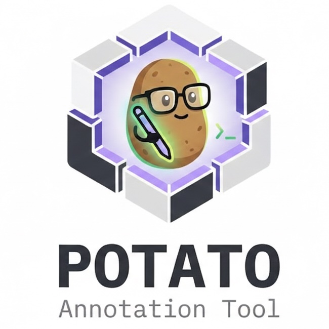

<p align="center">
  <picture>
    <source media="(prefers-color-scheme: dark)" srcset="docs/img/readme/logo-dark.jpg">
    
  </picture>
</p>

# Potato: The Portable Annotation Tool

[](https://www.potatoannotator.com/docs)
[](https://potatoannotator.readthedocs.io/)
[](https://pypi.org/project/potato-annotation/)
[](LICENSE)
[](https://aclanthology.org/2026.acl-demo.37/)
[](https://aclanthology.org/2022.emnlp-demos.33/)
[](https://huggingface.co/spaces/Blablablab/potato)

**Potato** is a free, open-source platform for collecting human annotations and judgments that you can run on your own machine or deploy to the cloud with one command. Researchers use it to label NLP and machine-learning datasets, evaluate AI agents and LLMs, run online experiments and surveys, code interviews for qualitative analysis, and review scientific and medical data. The same tool handles text, audio, video, images, documents, agent traces, 3D scans and more.

A Potato task is a single settings file plus your data. You can [design it in the browser](https://www.potatoannotator.com/designer), [have a coding agent build it](https://github.com/davidjurgens/potato-skill/), or [write it by hand](docs/quick-start.md). Because the whole task lives in one file, you can share it, reuse it, keep it under version control, and publish it next to a paper so others can run the same study.

**[Try the live demo](https://huggingface.co/spaces/Blablablab/potato)** (no installation) · **[potatoannotator.com](https://www.potatoannotator.com)**

<p align="center">
  <a href="https://www.potatoannotator.com">
    
  </a>
  <br>
  <sub>Entities · web agents · microscopy · interviews · bird calls · astronomy · model replies · sleep studies · proteins · glossing · lidar · NMR spectra · land cover. Potato 2.14.0 running on sample data.</sub>
</p>

---

## Who uses Potato

| If you are... | Potato gives you | Start here |
|---|---|---|
| **Building NLP or ML datasets** | Classification, span and entity labeling, pairwise preference, multi-annotator agreement, adjudication, and AI pre-labeling for annotators to correct | [Schema gallery](docs/annotation-types/schemas_and_templates.md) |
| **Evaluating AI agents and LLMs** | Step-by-step trace review for 15+ agent frameworks, web-agent replays, RAG checks, LLM-judge calibration, and CI gating | [Agent evaluation](docs/agent-evaluation/agent_traces.md) |
| **Running experiments and surveys** | Condition assignment, counterbalancing, jsPsych timelines, validated questionnaires, survey import from Qualtrics and REDCap, and recruiting through Prolific and other panels | [Experiment flow](docs/workflow/experiment_flow.md) |
| **Doing qualitative research** | A living codebook, in-vivo coding, memos and cases: the NVivo / ATLAS.ti / MAXQDA workflow, self-hosted and free | [QDA mode](docs/advanced/qda.md) |
| **Reviewing scientific or medical data** | Viewers for microscopy, whole slides, CT/MR volumes, EEG, protein structures, genome loci, spectra and astronomy cutouts | [Science viewers](docs/annotation-types/science/microscopy.md) |

---

## Build a task three ways

- **In the browser.** The [Potato Designer](https://www.potatoannotator.com/designer) lets you design an annotation study or a Solo Mode project in a visual form: pick annotation types, set up AI support, and download a config that runs with `potato start`.
- **With a coding agent.** Install the [Potato skill](https://github.com/davidjurgens/potato-skill) in Claude Code, Codex or Cursor. Describe the study, and the agent writes the task, runs it, checks the interface and exports the annotations. Potato also ships an [MCP server](docs/tools/mcp_server.md) (`potato mcp`).
- **By hand.** Copy one of the 200+ projects in [`examples/`](examples/), or a worked design from the [Potato Showcase](https://www.potatoannotator.com/showcase), and edit its `config.yaml`. Editors check the file as you type against the published [config schema](docs/api-reference/machine_readable.md).

```
# Claude Code
/plugin marketplace add davidjurgens/potato-skill
/plugin install potato-skill@potato

# Codex or Cursor
npx skills add davidjurgens/potato-skill --agent codex cursor
```

---

## Quick start

```bash
pip install potato-annotation
potato start path/to/config.yaml -p 8000
```

Then open [http://localhost:8000](http://localhost:8000). To try a ready-made task first, run one from a source checkout, which includes `examples/`:

```bash
git clone https://github.com/davidjurgens/potato.git
cd potato && pip install -e .
potato start examples/classification/single-choice/config.yaml -p 8000
```

To show a pilot to a few people, `potato share config.yaml` serves it on a temporary public URL. For anything longer-lived, see [Deploy and share](#deploy-and-share).

---

## What you can annotate

The tables below are a **representative sample, not a complete list.** Annotation schemes and data types can be combined freely, [custom layouts](examples/custom-layouts/) and raw HTML cover interfaces not listed here, and [plugins](docs/advanced/plugins.md) add new schema and display types. If your task isn't listed, Potato can probably still do it.

### Data types

| Modality | Capabilities |
|----------|-------------|
| **Text** | Classification, span labeling, entity linking, coreference, relations, events, pairwise comparison ([docs](docs/annotation-types/schemas_and_templates.md)) |
| **Agent traces** | Step-by-step evaluation of LLM agents, tool calls, ReAct chains and multi-agent systems ([docs](docs/agent-evaluation/agent_traces.md)) |
| **Web agents** | Screenshot replays with click and scroll overlays, or live browsing with automatic trace recording ([docs](docs/agent-evaluation/web_agent_annotation.md)) |
| **RAG pipelines** | Retrieval relevance, answer faithfulness, citation accuracy, hallucination marking |
| **Dialogue** | Turn-level annotation, conversation trees, live chat evaluation, and diarized transcripts synced to audio ([docs](docs/annotation-types/multimedia/audio_dialogue.md)) |
| **Audio** | Waveforms, segment labels, ELAN-style tiers, and 21 transcript and subtitle formats read directly, including Whisper, cloud ASR, SRT/VTT, YouTube captions, TextGrid and EAF. Without a transcript, Potato runs Whisper and speaker diarization locally ([docs](docs/annotation-types/multimedia/audio_annotation.md), [transcripts](docs/guides/working_with_transcripts.md)) |
| **Video** | Frame-by-frame labeling, temporal segments, object tracking ([docs](docs/annotation-types/multimedia/video_annotation.md)) |
| **Images** | Bounding boxes, polygons, brush masks, landmarks, classification ([docs](docs/annotation-types/multimedia/image_annotation.md)) |
| **Documents** | PDF, Word, Markdown, code and spreadsheets, with coordinate mapping ([docs](docs/annotation-types/format_support.md)) |
| **3D and volumes** | Lidar and photogrammetry point clouds with 3D boxes and per-point segments; CT and MR volumes (DICOM, NIfTI) painted in linked axial, coronal and sagittal views ([point clouds](docs/annotation-types/spatial/point_cloud.md), [volumes](docs/annotation-types/multimedia/volume_annotation.md)) |
| **Maps** | Points, lines and polygons on a map, pinned places, and regions of an outline map ([docs](docs/annotation-types/spatial/geo_annotation.md)) |
| **Microscopy and pathology** | Multichannel OME-Zarr and OME-TIFF with regions and cell classes; whole-slide regions to and from QuPath and ASAP; DICOM SEG and SR export ([microscopy](docs/annotation-types/science/microscopy.md), [clinical formats](docs/annotation-types/science/clinical_formats.md)) |
| **Signals** | Multi-channel EEG, ECG and sensor recordings (EDF/BDF, WFDB, CSV/Parquet) with interval, event and sleep-stage labels, exported as BIDS events ([docs](docs/annotation-types/science/time_series.md)) |
| **Biology** | Protein structures with residue selection; genome loci in igv.js for variant review ([proteins](docs/annotation-types/science/protein_structures.md), [genomes](docs/annotation-types/science/genome_loci.md)) |
| **Chemistry and spectra** | Draw or correct chemical structures, mark atoms, and pick and integrate peaks in NMR, IR and MS spectra ([structures](docs/annotation-types/science/chemical_structures.md), [spectra](docs/annotation-types/science/spectra.md)) |
| **Bioacoustics** | Spectrograms with time-frequency boxes ([docs](docs/annotation-types/multimedia/spectrogram_annotation.md)) |
| **Astronomy** | FITS cutouts as science/reference/difference triplets with light curves, for real/bogus vetting and morphology ([docs](docs/annotation-types/science/astronomy.md)) |

### Annotation schemes

| Scheme | Use case |
|--------|----------|
| Radio / checkbox / Likert / slider | Classification, multi-label, rating scales |
| Span annotation | NER, highlighting, hallucination marking |
| Pairwise and best-worst | A/B preference, ranking, best-worst scaling |
| Per-step ratings | Rate each agent action or dialogue turn |
| Free text | Open-ended responses with validation |
| Triage | Fast accept / reject / skip for data curation ([docs](docs/annotation-types/triage.md)) |
| Conditional logic | Questions that appear based on earlier answers ([docs](docs/configuration/conditional_logic.md)) |
| Interlinear glossing | Morpheme segmentation, glosses and a free translation per sentence ([docs](docs/annotation-types/text/interlinear_gloss.md)) |
| Ego networks | A respondent names people, answers questions about each, links who knows whom, and places them on a map ([docs](docs/annotation-types/structured/ego_network.md)) |
| Listening tests | MUSHRA, BS.1116, ACR, DCR, CCR, P.835 and ABX ([docs](docs/annotation-types/multimedia/listening_tests.md)) |
| Survey measures | Visual analogue scales, semantic differentials, constant-sum, price lists, belief elicitation ([docs](docs/annotation-types/measurement/vas.md)) |

---

## Agent and LLM evaluation

Potato reads traces from the major agent frameworks and lets people evaluate them for a whole trajectory, for each step, for spans of text inside a step, or side by side.

```bash
python -m potato.trace_converter --input traces.json --auto-detect --output data.jsonl
```

Supported formats: **OpenAI**, **Anthropic/Claude**, **ReAct**, **LangChain**, **LangFuse**, **WebArena**, **SWE-bench**, **SWE-Agent**, **OpenTelemetry**, **CrewAI / AutoGen / LangGraph**, **MCP**, **Aider**, **Claude Code**, **ATIF** and **Web Agent**.

| Level | What you annotate | Example |
|-------|------------------|---------|
| **Trajectory** | Task success, efficiency, safety | "Did the agent complete the task?" |
| **Step** | Whether each action was correct and well reasoned | A Likert rating on every agent step |
| **Span** | Specific text inside agent output | Highlight hallucinated claims |
| **Comparison** | Two agents side by side | "Which agent did better?" |

### From production traces to a CI gate

| Stage | What Potato provides |
|-------|----------------------|
| **Capture** | The `@traceable` [tracing SDK](docs/integrations/tracing_sdk.md), or POST traces to the ingestion webhook |
| **Route** | [Automation rules](docs/agent-evaluation/automation_rules.md) (`filter → sample → actions`) send incoming traces to queues, datasets, evaluators or webhooks |
| **Curate** | Versioned [datasets and experiments](docs/agent-evaluation/datasets_and_experiments.md), plus [semantic search and slices](docs/agent-evaluation/semantic_curation.md) |
| **Evaluate** | [Programmatic evaluators](docs/agent-evaluation/evaluators.md) (trajectory match, tool use, LLM judge, heuristics) and a side-by-side [model arena](docs/agent-evaluation/model_arena.md) |
| **Calibrate** | [Align LLM judges with human labels](docs/agent-evaluation/judge_alignment.md) for categorical, span and free-text outputs |
| **Gate** | [Run evals in pytest](docs/agent-evaluation/ci_evaluation.md) and fail CI when scores regress |

<details>
<summary><b>Ready-to-run agent evaluation examples</b></summary>

| Example | What it evaluates |
|---------|-------------------|
| [agent-trace-evaluation](examples/agent-traces/agent-trace-evaluation/) | Text agent traces with the MAST error taxonomy and hallucination spans |
| [visual-agent-evaluation](examples/agent-traces/visual-agent-evaluation/) | GUI agents, with screenshot grounding accuracy |
| [agent-comparison](examples/agent-traces/agent-comparison/) | Two agents side by side |
| [rag-evaluation](examples/agent-traces/rag-evaluation/) | RAG retrieval relevance and citation accuracy |
| [openai-evaluation](examples/agent-traces/openai-evaluation/) | OpenAI Chat API traces with tool calls |
| [anthropic-evaluation](examples/agent-traces/anthropic-evaluation/) | Claude messages with tool_use blocks |
| [swebench-evaluation](examples/agent-traces/swebench-evaluation/) | Coding agents, with patch correctness ratings |
| [multi-agent-evaluation](examples/agent-traces/multi-agent-evaluation/) | Multi-agent coordination (CrewAI, AutoGen, LangGraph) |
| [web-agent-review](examples/agent-traces/web-agent-review/) | Recorded web traces in the step-by-step overlay viewer |
| [web-agent-creation](examples/agent-traces/web-agent-creation/) | Live web browsing with automatic trace recording |
| [agent-testing](examples/agent-testing/) | Chat with a live agent, or a coding agent in a subprocess or Docker, then rate it |

</details>

---

## AI in the loop

- **LLM label suggestions.** Any LLM can pre-annotate items so annotators correct a draft instead of starting from nothing. Backends: OpenAI, Anthropic, Gemini, Ollama, vLLM, HuggingFace and OpenRouter ([docs](docs/ai-intelligence/ai_support.md)). Decision models (`systemone` for Jev, OpenJev or laya-serve, and in-process `laya`) pick one label without writing text; Solo Mode and the labeling engine use them, but `ai_support` does not accept them.
- **Labeling engine.** Models label the dataset and people label a blind random sample. Potato tests the machine labels against that sample under limits you set (for example, at most 5% wrong at 90% confidence), accepts the labels that pass, sends the rest to people, and writes a certificate saying what was tested on how many human labels. Run it from the annotation server or with `potato label run|status|certify|certificate|export` ([docs](docs/labeling-engine/overview.md)).
- **Active learning.** Puts the items a model is least sure about at the front of the queue, with uncertainty, BADGE, BALD, diversity and hybrid strategies ([docs](docs/ai-intelligence/active_learning_guide.md)).
- **Model training.** Train a model on the study's own annotations from the admin page, on the annotation server, on a GPU machine over ssh, on a SLURM cluster, or on a machine that polls for jobs. Each run is scored on held-out items, and its predictions can go back into the study as pre-labels to correct ([docs](docs/ai-intelligence/model_training.md)).
- **Solo Mode.** One person works with an LLM, and the LLM takes over more of the labeling as its agreement with that person improves ([docs](docs/solo-mode/solo_mode.md)).
- **Chat assistant.** A sidebar where annotators ask about hard items. It answers from your guidelines and never writes a label itself ([docs](docs/ai-intelligence/chat_support.md)).

<details>
<summary><b>What you can train</b> (38 trainers)</summary>

- Text, span and image classifiers, including training on annotators' vote splits and private training with DP-SGD; a scikit-learn classifier that needs no extra install
- Box and outline detectors, including on whole slides, microscopy planes, map rasters and spectrograms; Cellpose cell segmentation; SAM box-to-outline refinement
- 3D volume segmentation, point-cloud detection through your own detector, and video object tracking
- LayoutLMv3 document layout; vision-language fine-tuning for image questions, captions, grounding and GUI clicks
- An audio segment tagger, Whisper fine-tuning on corrected transcripts, and speaker diarization
- LLM fine-tuning on free-text answers, pairwise preferences and corrected agent traces; reward models from pairwise, ranking and best-worst answers; process reward models for agent steps
- Relation, event, coreference and dependency models; conversation-tree and interlinear-gloss models
- Molecular property models, spectrum peak picking, signal and sleep-stage labeling, and robot-episode phase, outcome and reward models
- Bridges that score a model running elsewhere: a Label Studio ML backend, a vision-language model behind an OpenAI-compatible API, a Hugging Face Inference Endpoint, Roboflow and CVAT serverless functions

</details>

---

## Qualitative data analysis (QDA)

Potato supports interpretive qualitative research of the kind done in NVivo, ATLAS.ti or MAXQDA. Turn it on with `qda_mode` ([guide](docs/advanced/qda.md), [example](examples/advanced/qda-mode-example/)).

| Capability | Description |
|------------|-------------|
| **Living codebook** | The codebook is a markdown document of rules, definitions, examples and rationales, not just a list of labels. Edit it full-page or inline while coding, with versions, diffs and restore; changing a definition can flag affected excerpts for another look ([docs](docs/advanced/codebook.md)) |
| **In-vivo coding** | Make a code from a highlighted passage, in the participant's own words ([example](examples/advanced/codebook-invivo-example/)) |
| **Memos** | Notes on excerpts, codes or the whole project ([docs](docs/advanced/memos.md)) |
| **Cases** | Group items into participants, interviews, documents or sites to compare cases ([docs](docs/advanced/cases.md)) |
| **Search** | Full-text search across the corpus and its annotations ([docs](docs/advanced/search.md)) |
| **Codebook distillation** | Turn the codebook into an LLM prompt for AI-assisted coding |

---

## Experiments and surveys

| Capability | Description |
|------------|-------------|
| **Experiment flow** | Assign participants to conditions, show or skip pages by condition, screen participants out, counterbalance page order, and randomize questions ([docs](docs/workflow/experiment_flow.md)) |
| **Runtime phases** | Run a jsPsych timeline, a headphone check, or a task hosted elsewhere (oTree, Empirica, a survey platform) as one page of the study ([docs](docs/workflow/runtime_phases.md)) |
| **Survey import** | `potato import` converts Qualtrics, SurveyJS, LimeSurvey, XLSForm, REDCap, Beiwe and Network Canvas questionnaires, including their show/hide logic ([docs](docs/tools/survey_import.md)) |
| **Survey instruments** | A library of validated questionnaires (personality, mental health, affect, demographics) for pre- and post-study pages ([docs](docs/advanced/survey_instruments.md)) |
| **Self-paced reading** | Self-paced reading and the Maze task, with a reading time for each region ([docs](docs/workflow/self_paced_reading.md)) |
| **Scheduled sessions** | Follow-up waves, experience sampling and Delphi rounds, with email, SMS or Prolific reminders ([docs](docs/workflow/scheduling.md)) |
| **Writing process** | Content-blind keystroke timing that tells typed answers from pasted or transcribed ones ([docs](docs/advanced/keystroke_logging.md)) |

---

## Quality and agreement

| Feature | Description |
|---------|-------------|
| Training phase | Practice items with feedback before the real task |
| Attention checks and gold items | Known-answer items to check engagement and track accuracy ([docs](docs/workflow/quality_control.md)) |
| Inter-annotator agreement | Krippendorff's alpha, Cohen's kappa, and per-step agreement for agent evaluation |
| Behavioral tracking | Timing, clicks and the history of changes to each answer ([docs](docs/advanced/behavioral_tracking.md)) |
| **Psychometrics** | Item response theory (multiclass GLAD, Whitehill et al. 2009) fit live as answers arrive: label estimates per item, annotator ability with standard errors, item difficulty, and discrimination flags that point at codebook bugs. No gold labels or LLM needed ([docs](docs/advanced/psychometrics.md)) |
| **Truth Serum** | Surprisingly-popular scoring (Prelec et al., *Nature* 2017): verdicts without gold labels that beat majority vote on hard items, plus annotator calibration ([docs](docs/advanced/truth_serum.md)) |
| **Boundary probing** | Counterfactual probes map where each annotator's decision changes, and paraphrase checks flag inconsistency ([docs](docs/advanced/boundary_lab.md)) |

---

## Running a study

| Workflow | Description |
|----------|-------------|
| **Multiple annotators** | Several people per item, with overlap control and agreement metrics ([docs](docs/advanced/task_assignment.md)) |
| **Adjudication** | An expert resolves disagreements to produce final labels ([docs](docs/administration/adjudication.md)) |
| **Live collaborative sessions** | A team annotates the same items at once and keeps one shared answer per item ([docs](docs/advanced/collaborative_sessions.md)) |
| **Multiplayer rooms** | Norming (blind vote, reveal, discuss), disagreement huddles, and shadowing for trainees ([docs](docs/advanced/multiplayer_rooms.md)) |
| **Pocket Mode** | Annotate on a phone: an installable app with one-tap labels that works offline and syncs later ([docs](docs/advanced/pocket_mode.md)) |
| **Crowdsourcing** | Prolific, CloudResearch Connect, SONA, Microworkers, Clickworker, invite links for hired experts, and any panel that passes a participant ID in the URL ([docs](docs/deployment/crowdsourcing.md), [choosing a platform](docs/deployment/crowdsourcing-platforms.md)) |
| **Admin dashboard** | Progress, agreement, annotator timing and exports in one place ([docs](docs/administration/admin_dashboard.md)) |
| **Paper Mode** | `python -m potato.paper config.yaml` writes a compilable LaTeX dataset report with methods paragraphs, booktabs tables, agreement and limitations ([docs](docs/advanced/paper_mode.md)) |
| **Think-aloud** | Annotators speak while they work. Speech is transcribed locally and kept as a rationale, and spoken phrases can commit a label, with no LLM involved ([docs](docs/advanced/think_aloud.md)) |

---

## Deploy and share

`potato deploy up config.yaml --provider <target>` creates a server, gets an HTTPS certificate and starts the task. Targets include AWS, Jetstream2 and other OpenStack clouds, Hetzner, Vultr, Linode, DigitalOcean, Fly.io, Railway, Render, Heroku and HuggingFace Spaces. On hosts whose disk doesn't survive a restart, `--backup hf|s3` keeps the annotations in a dataset or bucket and restores them when the server starts. `potato deploy button` writes Deploy to Heroku, Deploy to Render and AWS Launch Stack buttons for a task's repository. Start with [Installing and running Potato](docs/deployment/installation.md).

Login options: simple usernames for quick studies, passwords stored in a file or in SQLite / PostgreSQL, Google, GitHub or institutional single sign-on, Clerk, and passwordless links ([docs](docs/auth-users/sso_authentication.md)). Passwords are hashed with PBKDF2-SHA256 and a salt per user, and can be reset by an admin (`potato reset-password` or the REST API), who can also issue a single-use reset link. `potato snapshot` freezes a project under an ID you can cite ([docs](docs/tools/snapshots.md)).

---

## Examples and live demos

[`examples/`](examples/) holds ready-to-run projects, each a folder with a `config.yaml` and its data:

| Category | Examples |
|----------|----------|
| [Classification](examples/classification/) | Radio, checkbox, Likert, slider, pairwise comparison |
| [Span](examples/span/) | NER, span linking, coreference, entity linking |
| [Agent traces](examples/agent-traces/) | LLM agents, web agents, RAG, multi-agent, coding agents |
| [Audio](examples/audio/) / [Video](examples/video/) / [Image](examples/image/) | Waveforms, tiers, temporal segments, boxes, PDF and document annotation |
| [Conversation](examples/conversation/) | ConvoKit corpora, threaded forums, conversation trees |
| [Spatial](examples/spatial/) / [Embodied](examples/embodied/) | Lidar (KITTI), depth maps, robot episodes in LeRobot format |
| [Advanced](examples/advanced/) | QDA, Solo Mode, adjudication, collaborative sessions, Pocket Mode |
| [Crowdsourcing](examples/crowdsourcing/) | Prolific, CloudResearch Connect, SONA, Microworkers, expert invites |
| [Labeling engine](examples/labeling-engine/) | Certified machine labels for text, images and agent traces |
| [Plugins](examples/plugins/) | A minimal plugin package that adds a display type |

**Live demos.** The [flagship demo](https://huggingface.co/spaces/Blablablab/potato) runs agent trace evaluation, and the [demo catalog](docs/data-export/potato_on_huggingface.md) has a HuggingFace Space for every annotation type. [Deploy your own](deployment/huggingface-spaces/deploy_spaces.md) from a single manifest.

**Research showcase.** The [Potato Showcase](https://www.potatoannotator.com/showcase) has 500+ worked task designs from many domains, including projects from published research on sentiment analysis, dialogue evaluation and summarization.

---

## Documentation

**[potatoannotator.com/docs](https://www.potatoannotator.com/docs)** has guides and tutorials. **[Read the Docs](https://potatoannotator.readthedocs.io/)** has the version-matched reference: every config option, the HTTP API and internals.

[Quick start](docs/quick-start.md) · [Configuration](docs/configuration/configuration.md) · [Schema gallery](docs/annotation-types/schemas_and_templates.md) · [Agent evaluation](docs/agent-evaluation/agent_traces.md) · [AI support](docs/ai-intelligence/ai_support.md) · [Quality control](docs/workflow/quality_control.md) · [Crowdsourcing](docs/deployment/crowdsourcing.md) · [Export formats](docs/data-export/export_formats.md) · [Comparison with other tools](docs/comparison.md) · [FAQ](docs/faq.md) · [Full index](docs/index.md)

### For coding agents

Start with the [Potato skill](https://github.com/davidjurgens/potato-skill) ([install commands per agent](docs/tools/authoring-agents.md)) or the [MCP server](docs/tools/mcp_server.md). Without either, an agent can work from these specs. The config schema and OpenAPI spec are generated from the code, so they match what the server accepts:

| File | What it gives you |
|------|-------------------|
| [`llms.txt`](https://potatoannotator.readthedocs.io/en/latest/llms.txt) | Curated index of the docs ([llms.txt standard](https://llmstxt.org)) |
| [`llms-full.txt`](https://potatoannotator.readthedocs.io/en/latest/llms-full.txt) | Every documentation page in one file |
| [Config JSON Schema](https://potatoannotator.readthedocs.io/en/latest/schemas/potato-config.schema.json) | Every config key, annotation type and display type; validates a `config.yaml` before the server runs |
| [OpenAPI 3.1 spec](https://potatoannotator.readthedocs.io/en/latest/api-reference/openapi.json) | Every HTTP path, with its auth and config requirements |

See [Machine-readable specs](docs/api-reference/machine_readable.md) for editor setup, CI validation and `jq` recipes.

---

## Contributing

Bug fixes, new annotation types, documentation fixes and example projects are welcome. [CONTRIBUTING.md](CONTRIBUTING.md) covers setup and what to run before opening a PR, and the [contributor guide](docs/guides/contributing.md) and [testing guide](docs/guides/testing.md) cover adding an annotation type and which test tier to write in.

## Support

- **Issues**: [GitHub Issues](https://github.com/davidjurgens/potato/issues)
- **Questions**: jurgens@umich.edu

## License

Potato is free software under the [GNU General Public License v3.0 or later](LICENSE). You may use, study, modify and redistribute it, including commercially, provided that derivative works you distribute are also licensed under GPLv3+ and shipped with their source code.

---

## Citation

If you use Potato in your research, please cite the **Potato 2.0** paper ([ACL 2026 System Demonstrations](https://aclanthology.org/2026.acl-demo.37/)):

```bibtex
@inproceedings{jurgens-etal-2026-potato,
    title = "Potato 2.0: A Comprehensive Annotation Platform with {AI}-in-the-Loop Support",
    author = "Jurgens, David  and
      Chen, Michael  and
      Iyer, Lina",
    editor = "Durrett, Greg  and
      Jian, Ping",
    booktitle = "Proceedings of the 64th Annual Meeting of the Association for Computational Linguistics (Volume 3: System Demonstrations)",
    month = jul,
    year = "2026",
    address = "San Diego, California, United States",
    publisher = "Association for Computational Linguistics",
    url = "https://aclanthology.org/2026.acl-demo.37/",
    pages = "374--386",
    ISBN = "979-8-89176-392-0",
}
```

To reference the original Potato release, cite the **Potato 1.0** paper ([EMNLP 2022 System Demonstrations](https://aclanthology.org/2022.emnlp-demos.33/)):

```bibtex
@inproceedings{pei-etal-2022-potato,
    title = "{POTATO}: The Portable Text Annotation Tool",
    author = "Pei, Jiaxin  and
      Ananthasubramaniam, Aparna  and
      Wang, Xingyao  and
      Zhou, Naitian  and
      Dedeloudis, Apostolos  and
      Sargent, Jackson  and
      Jurgens, David",
    editor = "Che, Wanxiang  and
      Shutova, Ekaterina",
    booktitle = "Proceedings of the 2022 Conference on Empirical Methods in Natural Language Processing: System Demonstrations",
    month = dec,
    year = "2022",
    address = "Abu Dhabi, UAE",
    publisher = "Association for Computational Linguistics",
    url = "https://aclanthology.org/2022.emnlp-demos.33/",
    doi = "10.18653/v1/2022.emnlp-demos.33",
    pages = "327--337",
}
```
