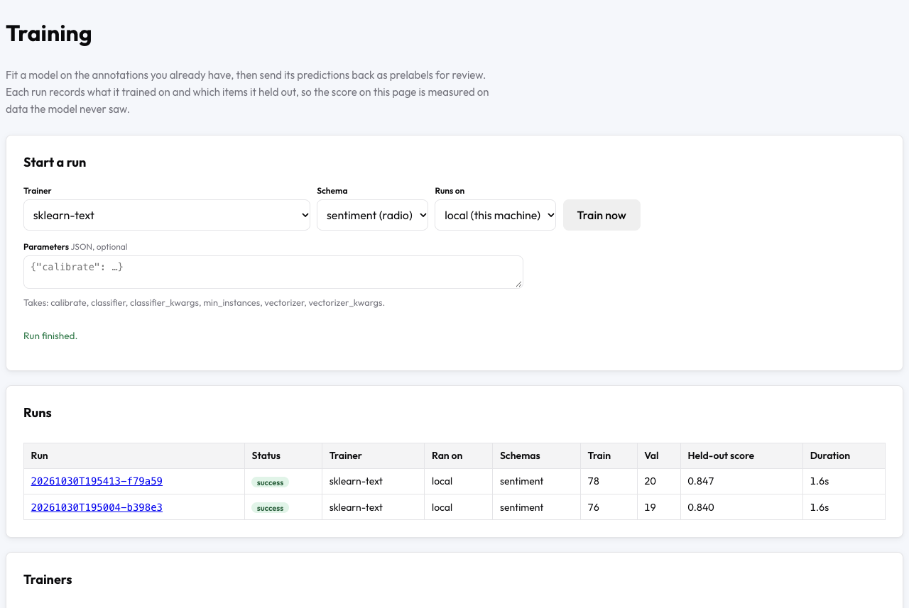
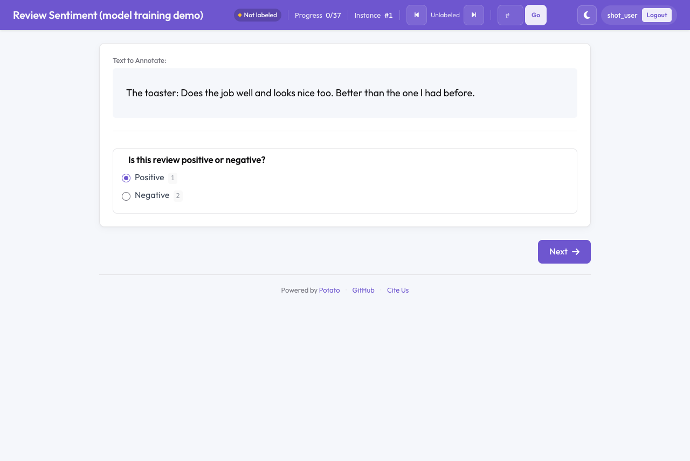

# Model Training

Model training fits a model on the study's own annotations, from the admin
Training page at `/admin/training`: a classifier for choice schemes, a span
tagger for span schemes, an object detector or instance segmenter for image
shapes, a segment tagger for audio, or an LLM fine-tuned on free-text answers
or on pairwise preferences. It can also fine-tune Laya or OpenJev, or
calibrate any decision model (Jev, OpenJev, laya-serve, Laya) to the study's
labels. Each
run resolves the annotations to one
label per item, splits the items into train, val and test, fits the model in a
separate process, and records what it trained on and which items it held out.
A run's predictions can then be written back to items as prelabels, which the
[model review](model_review.md) workflow serves least-confident first.

The labeling engine uses the same trainers. [Distillation](../labeling-engine/configuration.md#distill)
fits one on the engine's labels, and a `trained` source loads a fitted model's
directory (`artifact_dir`).

---

## Quick start

```yaml
model_training:
  enabled: true
```

Restart the server, open `/admin/training`, pick a trainer and a scheme, and
click **Train now**. Nothing is shown to annotators until you name schemes
under `writeback.schemas`.



[`examples/ai-assisted/model-training/`](https://github.com/davidjurgens/potato/tree/master/examples/ai-assisted/model-training)
is a complete project: 160 product reviews, a gold file the
[simulator](../tools/simulator.md) can annotate from, and `sklearn-text`,
which needs nothing beyond a plain install. Its config comments give the
commands. With 120 of the reviews labelled, one run there scored 0.84 val
macro-F1 and published 80 prelabels: on the 40 reviews nobody had labelled
and on the held-out val and test reviews, less 4 below `min_confidence`. A
new annotator then sees the model's answer selected:



---

## Configuration

All keys sit under `model_training`:

| Key | Default | Meaning |
|---|---|---|
| `enabled` | `false` | Registers the `/admin/training` routes and the training manager. Without it the routes do not exist. |
| `retain_runs` | `5` | Finished runs kept in the run ledger. Older runs are dropped from it unless their predictions are still stored. The run directories stay on disk. |
| `grace_seconds` | `20` | After a cancel, seconds the run gets to exit before it is killed. |
| `split_seed` | `0` | Seeds the split assignment. Keep it fixed: changing it moves held-out items into training. |
| `splits` | `{train: 0.7, val: 0.15, test: 0.15}` | Split fractions, normalized to sum to 1. Use the names `train`, `val` and `test`: predictions are made for `val` and `test` (and for unlabelled items with `writeback.include_unlabeled`). |
| `aggregation` | `consensus` | How several annotators' labels become one. `consensus` is Dawid-Skene when there is more than one annotator (falling back to majority vote if it fails); `majority` is majority vote. |
| `max_wall_seconds` | unset | Time limit for one run. The server stops a run that exceeds it: a local run is checked each time it reports an event, an ssh or agent run every second. |
| `max_ram_mb` | unset | Address-space limit for the training process (`setrlimit`). Where the platform does not support the limit, the run logs a warning and continues. |
| `device` | `auto` | `auto`, `cpu`, `cuda`, `cuda:N` or `mps`. See [Training on this machine](#training-on-this-machine). |
| `num_threads` | unset | Sets `OMP_NUM_THREADS`, `MKL_NUM_THREADS` and `OPENBLAS_NUM_THREADS` for the run, unless they are already set. |
| `auto_retrain` | off | Retrain as annotations arrive. See below. |
| `writeback` | none | Publish predictions as prelabels. See below. |
| `backend` | `local` | Where runs execute unless the Training page or the API names another. See [Where runs execute](#where-runs-execute). |
| `backends` | none | Named ssh and agent backends. |
| `max_predictions_mb` | `512` | Largest `predictions.jsonl` a remote agent may upload. |
| `trainer_params` | none | Parameter defaults per trainer. See [Parameters](#parameters). |

### `auto_retrain`

| Key | Default | Meaning |
|---|---|---|
| `enabled` | `false` | Check for a retrain after every annotation save. |
| `trainer` | none | Trainer name. Required. |
| `schemas` | none | Schemes to train. Required. |
| `min_interval_s` | `600` | Seconds since the last run finished before another starts. |
| `update_frequency` | `25` | New annotations since the last automatic run before another starts. |
| `params` | `{}` | Trainer parameters, as in the `params` of an API run. |
| `backend` | `model_training.backend` | Backend for automatic runs. |
| `accept_licence` | `false` | Confirms the licence of a trainer that asks for it (`ultralytics-detect`, `ultralytics-segment`). Without it, automatic runs of that trainer are skipped and `skip_reason` says why. |

When a check decides not to start a run, the reason ("waiting for 3 more
annotation(s)", "a run is already in progress") is in the `skip_reason` field
of `GET /admin/training/api/status`.

The counts are kept in memory. After a restart, a project that has run before
counts new annotations from the restart, and `min_interval_s` runs from the
last run's finish. A project with no run yet trains once it has
`update_frequency` annotations.

`min_interval_s` and `update_frequency` must be numbers of at least 0, and
`enabled` and `accept_licence` must be `true` or `false`. With `enabled: true`,
`validate` and server start also check the trainer, the schemes and the
parameters, as listed under [Checks before a run](#checks-before-a-run).

### `writeback`

| Key | Default | Meaning |
|---|---|---|
| `schemas` | `[]` | Schemes whose predictions are shown to annotators. Empty means none. |
| `min_confidence` | `0.0` | Predictions below this confidence are not published. A prediction with no confidence passes. |
| `field` | `predictions` | Item field the prelabels are written to. |
| `include_unlabeled` | `false` | Also predict on the items nobody has labelled yet, and prelabel them. Without it a run predicts only on its held-out `val` and `test` items. |

### Example

```yaml
model_training:
  enabled: true
  retain_runs: 5
  split_seed: 0
  splits: {train: 0.7, val: 0.15, test: 0.15}
  aggregation: consensus
  max_wall_seconds: 1800
  max_ram_mb: 4096
  num_threads: 4
  auto_retrain:
    enabled: true
    trainer: sklearn-text
    schemas: [sentiment]
    min_interval_s: 600
    update_frequency: 25
    params:
      classifier: sklearn.linear_model.LogisticRegression
      classifier_kwargs: {max_iter: 1000}
  writeback:
    schemas: [sentiment]
    min_confidence: 0.8
    include_unlabeled: true
```

### Checks before a run

`potato validate` reports an error, and the server does not start, for a
config with any of these. Both list every one they find:

- `splits` with a name other than `train`, `val` and `test`, a fraction that
  is not a number of at least 0, fractions that sum to 0, or no `train`;
- a key `writeback` or `auto_retrain` does not have (`accept_license` is
  reported as a misspelling of `accept_licence`), a `writeback.schemas` entry
  that is not a scheme, or a `min_confidence` outside 0 to 1;
- an enabled `pre_annotation` block whose `field` is not `writeback.field`
  (see [Write-back](#write-back));
- with `auto_retrain.enabled`, a trainer or scheme that does not exist, a
  scheme the trainer cannot learn, parameters the trainer does not take or
  of the wrong type, a `backend` not under `backends`, or a trainer that runs
  only locally (`decision-calibrate`) on another backend;
- a parameter under `trainer_params` that its trainer does not take, or of
  the wrong type;
- under `backends`, a missing or unknown `type`, a key that type does not
  have, an ssh backend with no `host`, a `gpus` value other than `auto`,
  `none` or GPU indices, a backend other than this machine named `local`, or
  a `model_training.backend` that is not defined;
- a decision model's `calibration` file that does not exist (see
  [`decision-calibrate`](#decision-calibrate)).

A run started from the page or the API is checked again when it starts; see
[Routes](#routes) for the status codes.

---

## Where runs execute

A run executes on a *backend*. There are three kinds:

| Type | Where the trainer runs | Who starts it |
|---|---|---|
| `local` | This machine, in a subprocess. Always available, and the default. | Potato |
| `ssh` | Another machine Potato can reach over ssh, such as a GPU server. | Potato, over ssh |
| `agent` | A machine Potato cannot reach, such as a workstation behind NAT. | Someone, with `potato training agent` |

The Training page has a **Runs on** menu listing them. `model_training.backend`
sets the default, and an API run or `auto_retrain` can name one with
`backend`.

### Training on this machine

`device` picks the accelerator: `auto` takes CUDA, then Apple's Metal
(`mps`), then the CPU, and `cuda:N` names one GPU. On a Mac with Apple
silicon the transformer trainers and the `sentence-transformers` and `clip`
vectorizers run on Metal with no configuration; `torchvision-detect` and
`torchvision-segment` train on the CPU there (see their sections). A device
that was asked for and is not present falls back to the CPU or another
accelerator, with a warning in the run log. The run log names the device:
"Training on ..." for the transformer and detection trainers,
"Embedding on ..." for `sklearn-text`. `model_card.json` records it too. TF-IDF and other
vectorizers that do not use torch ignore `device`.

`potato training check local config.yaml` prints the device a local run
would use.

### A GPU server over ssh

```yaml
model_training:
  enabled: true
  backend: gpu-server          # the default for runs; omit to keep local
  backends:
    gpu-server:
      type: ssh
      host: gpu.example.edu      # any name ssh accepts, including ~/.ssh/config aliases
      python: /opt/conda/bin/python3
      gpus: auto
      min_free_gpu_mb: 4000
```

For each run, Potato:

1. Connects with `ssh` (key-based authentication; `BatchMode` is on, so a
   password prompt fails instead of hanging).
2. Checks the interpreter and reads `nvidia-smi`. With `gpus: auto` it picks
   the GPU with the most free memory and refuses to start when none has
   `min_free_gpu_mb` free. A host with no GPU at all runs on its CPU.
3. Copies Potato's own Python source to `remote_dir/code/<hash>`. The hash
   covers every `.py` file, so the remote host runs the same code as the
   server, whether that is a release or a working copy. A host that already
   has the hash gets no upload.
4. Opens a reverse forward from a unix socket on the remote host back to this
   server, and starts `python -m potato.training.agent` for the run.
5. The agent downloads the run's bundle, runs the same training worker the
   local backend runs, and sends progress, predictions and the result back
   through the socket.
6. When the run succeeds, Potato copies the artifact directory back into the
   run's `artifacts/`, so the model is on the server as it would be after a
   local run. It then deletes the remote job directory and closes the
   connection.

The remote host needs only Python 3.8 or newer and the trainer's packages.
To check a backend before training, click
**Check** on the Training page or run:

```bash
potato training check gpu-server config.yaml
```

It reports the Python version, every GPU with its free memory, the GPU a run
would get, and which training packages the remote interpreter lacks.
`--json` prints the same as JSON.

| Key | Default | Meaning |
|---|---|---|
| `host` | required | The ssh destination. |
| `description` | none | Free text, returned with the backend by `GET /admin/training/api/backends`. |
| `user`, `port`, `identity_file` | ssh's own | Passed to `ssh` as `-l`, `-p` and `-i`. |
| `ssh_options` | `[]` | More `-o` options, as `["Option=value", ...]`. |
| `python` | `python3` | Interpreter on the remote host. |
| `packages` | `[]` | Packages to install for the trainer. Potato makes a virtual environment with `--system-site-packages` under `remote_dir`, so the host's own CUDA build of torch is reused, and installs these into it once. |
| `gpus` | `auto` | `auto`, `none`, or indices such as `"1"` or `"0,1"`. Sets `CUDA_VISIBLE_DEVICES`. |
| `min_free_gpu_mb` | `2000` | With `gpus: auto`, the free memory a GPU needs. |
| `remote_dir` | `~/.cache/potato-training` | Code cache and job directories on the remote host. |
| `num_threads` | unset | Sets `OMP_NUM_THREADS` and its siblings for the run. Some shared servers set `OMP_NUM_THREADS=1` in login shells. |
| `env` | `{}` | More environment variables for the agent. A `PYTHONPATH` here is added after Potato's code. |
| `fetch_artifacts` | `true` | Copy the artifacts back after a successful run. |
| `max_artifact_mb` | `2048` | Files larger than this stay on the remote host, and the run log names them. |
| `keep_remote` | `false` | Keep the remote job directory after the run. |
| `connect_timeout_s` | `15` | ssh connection timeout. |
| `heartbeat_timeout_s` | `120` | A run whose agent sends nothing for this long fails. |
| `queue_timeout_s` | unset | Seconds a run may wait to start before it fails. |

**What the remote host can see.** The forward is a unix socket in the remote
`/tmp`, created with mode `0600`, so only the account Potato logged in as can
connect through it. Requests that arrive through it are loopback requests to
this server, and with `debug: true` Potato grants admin access to loopback
requests, so anyone who can use that account on the remote host has admin
access while a run is in progress. The run's token reaches the agent on stdin
and is never in a command line, because command lines are visible to every
account on a shared server. The token is valid for that run only.

### A machine Potato cannot reach (`type: agent`)

```yaml
model_training:
  enabled: true
  backends:
    lab-workstation:
      type: agent
      queue_timeout_s: 3600
```

Issue a token on the server, then start the agent on the training machine:

```bash
# On the server
potato training register lab-workstation config.yaml

# On the training machine, which needs Potato and the trainer's packages
export POTATO_TRAINING_TOKEN=<the token>
potato training agent --server https://annotate.example.edu --backend lab-workstation
```

The agent polls the server and runs jobs for its backend until stopped.
`--token-file` reads the token from a file instead of
`POTATO_TRAINING_TOKEN`, `--python` names the interpreter the training worker
runs in (default: the agent's own), `--once` exits after one job,
`--workdir` moves its files (default `~/.cache/potato-training`), and
`--keep` keeps each job's bundle. The agent
needs no inbound port: it opens every connection, and a cancel reaches it in
the response to its next progress report. Registering the name again issues a
new token and invalidates the old one.

A run for an agent backend waits in the `queued` state until an agent asks
for work. With `queue_timeout_s` set, it fails after that many seconds with no
agent. Without it, it waits until cancelled.

Model files from an `agent` backend stay on that machine; only predictions
and the result come back. The run record's `artifact_uri` names where they
are.

An agent backend takes `type`, `description`, `heartbeat_timeout_s` (default
120) and `queue_timeout_s`, with the meanings in the ssh table above, and no
other key.

---

## Trainers

| Trainer | Schemes | Items | Install |
|---|---|---|---|
| `sklearn-text` | `radio`, `select`, `likert`, `multiselect` | text, images | nothing |
| `hf-text-classification` | `radio`, `select`, `likert`, `multiselect` | text | `potato-annotation[train-text]` |
| `setfit` | `radio`, `select`, `likert`, `multiselect` | text | `potato-annotation[embeddings]` |
| `hf-token-classification` | `span` | text | `potato-annotation[train-text]` |
| `hf-image-classification` | `radio`, `select`, `likert`, `multiselect` | images | `potato-annotation[train-vision]` |
| `llm-sft` | `text` (free-text answers), `trajectory_edit` | text | `potato-annotation[train-llm]` |
| `llm-dpo` | `pairwise` in `binary` mode, `trajectory_edit` | text | `potato-annotation[train-llm]` |
| `prm-reward` | `process_reward` | agent traces | `potato-annotation[train-text]` |
| `torchvision-detect` | `image_annotation` | images | `potato-annotation[train-vision]` |
| `ultralytics-detect` | `image_annotation` | images | `pip install ultralytics` (AGPL-3.0) |
| `torchvision-segment` | `image_annotation` (outlines) | images | `potato-annotation[train-vision]` |
| `ultralytics-segment` | `image_annotation` (outlines) | images | `pip install ultralytics` (AGPL-3.0) |
| `hf-audio-tagger` | `audio_annotation` | audio | `potato-annotation[train-audio]` |
| `decision-calibrate` | `radio`, `select`, `likert`, `slider` | text | nothing; a configured decision model |
| `laya-finetune` | `radio`, `select`, `likert`, `slider` | text | `potato-annotation[decision]` |
| `openjev-finetune` | `radio`, `select`, `likert`, `slider` | text | `pip install wev-ai`; a GPU with about 16 GB free |
| `label-studio-ml` | `radio`, `select`, `multiselect`, `span`, `image_annotation` | text, images | nothing; a running Label Studio ML backend |

`pip install "potato-annotation[train]"` installs what the text, image,
audio and LLM trainers need. Laya (`[decision]`), `wev-ai` and `ultralytics`
are separate installs. None of these is part of `potato-annotation[all]`,
because torch is a multi-gigabyte install. A trainer that is not installed is
listed on the Training page as "not installed", with the command that
installs it.

For each scheme, the Training page offers only the trainers that fit it: its
kind, and whether the items are text, images or audio. A trainer the project
cannot run is listed with the reason, such as `decision-calibrate` with "no
decision model is configured". Until you pick a trainer, `sklearn-text` is
selected when it fits. A run started for a scheme that does not exist, or one
the trainer cannot learn, is refused with HTTP 400 before anything is built.
Every trainer except `decision-calibrate` runs on any
[backend](#where-runs-execute).

**One scheme per run.** The page sends one scheme. The API accepts a list,
but every trainer fits only the first scheme named.

### Parameters

A run's parameters come from three places, each overriding the one before:

1. the trainer's defaults (the tables below);
2. `model_training.trainer_params.<trainer>` in the config;
3. the run's own `params`: the **Parameters** field on the Training page, the
   `params` of an API run, or `auto_retrain.params`.

```yaml
model_training:
  enabled: true
  trainer_params:
    hf-text-classification:
      model_name: answerdotai/ModernBERT-base
      epochs: 4
    llm-sft:
      model_name: Qwen/Qwen2.5-1.5B-Instruct
      gradient_checkpointing: true
```

The Parameters field is JSON, filled in from `trainer_params` for the chosen
trainer, and the note under it lists the names the trainer takes. A name the
trainer does not take is refused when the run starts, and at boot when it is
under `trainer_params`, with the list of names it does take. The run page
shows the parameters a run used.

`hf-text-classification`, `hf-token-classification`, `hf-image-classification`
and `hf-audio-tagger` take these. The other trainers list their own parameters
in their sections:

| Parameter | Default | Meaning |
|---|---|---|
| `model_name` | per trainer | A Hugging Face model id or a local directory. |
| `epochs` | 5 (token 8, audio 10) | Passes over the training split. |
| `batch_size` | 16 (token and audio 8) | Items per step. |
| `gradient_accumulation` | 1 | Batches per optimizer step: a larger effective batch without the memory. |
| `learning_rate` | text 3e-5, tokens 5e-5, images 5e-5, audio 5e-5 | With `lora`: 2e-4, 3e-4, 5e-4 and 5e-4. |
| `weight_decay` | 0.01 | AdamW weight decay. |
| `warmup_ratio` | 0.1 | Share of steps spent warming the learning rate up, before a linear decay. |
| `patience` | 2 (token and audio 3) | Stop after this many epochs without a better val score; `null` trains every epoch. |
| `precision` | `auto` | `auto` or `bf16` trains in bf16 on a GPU that supports it and in fp32 elsewhere; `fp32` forces full precision. |
| `lora` | off | `true` trains a LoRA adapter (r 16, alpha 32, dropout 0.05) instead of every weight; or an object with `r`, `alpha`, `dropout` and `target_modules`. |
| `min_instances` | 20 (audio 10) | Refuse to fit with fewer items in the train split. |

With a val split, these trainers keep the checkpoint from the epoch that scored
best on val. That makes val a split the trainer has looked at, so the run's
held-out score is taken from test (see [Held-out scores](#held-out-scores)).

### `sklearn-text`

`sklearn-text` needs no optional install for text, because scikit-learn is a
core dependency.

- **Kinds:** `nominal` (`radio`, `select`), `ordinal` (`likert`) and
  `multilabel` (`multiselect`). A multilabel target is trained as one class per
  combination of labels.
- **Modalities:** `text` and `image`.

Parameters, set as described in [Parameters](#parameters):

| Parameter | Default | Meaning |
|---|---|---|
| `classifier` | `sklearn.linear_model.LogisticRegression` | Dotted path to any scikit-learn-API estimator. An `SVC` gets `probability: true` so it can report confidence. |
| `classifier_kwargs` | `{}` | Passed to the estimator's constructor. |
| `vectorizer` | `sklearn.feature_extraction.text.TfidfVectorizer` | A dotted path, `sentence-transformers`, or `clip` (also `image`) for images. On an image corpus the default is `clip`. |
| `vectorizer_kwargs` | `{}` | For a dotted path, passed to the constructor (`ngram_range` may be a list). For `sentence-transformers`, `model_name` (default `all-MiniLM-L6-v2`). For `clip`, `model_name` (default `clip-ViT-B-32`), `cache_dir` and `image_root`. |
| `calibrate` | `true` | Calibrate the confidences, and keep the calibrated model only if it did not cost more than 0.05 training accuracy. Skipped below 50 training items, or when the smallest class has fewer than 2. Platt scaling below 1000 items, isotonic from there. |
| `min_instances` | `10` | Refuse to fit with fewer items in the train split. |

The classifier and vectorizer take dotted paths only. The short names that
[active learning](active_learning_guide.md) accepts (`tfidf`, `logistic`) are
not expanded here: a name that cannot be imported falls back to the default
with a warning in the run's log.

On an [image corpus](#image-items) the default vectorizer is `clip`.

A text vectorizer always reads the item's text (the `text_key` field), never a
media or URL field. The run's `model_card.json` records `input: text` or
`input: media`, and prediction feeds the model the same input it was fitted on.

`sentence-transformers` and `clip` need
`pip install "potato-annotation[embeddings]"` (`clip` also needs `pillow`).
When they are missing, the run fails with the install command.

Accuracy on the training split is recorded as `train_accuracy`. It is never
the run's score.

### `hf-text-classification`

Fine-tunes any model `AutoModelForSequenceClassification` loads. Default model:
`distilbert/distilroberta-base`.

- `multiselect` gets one sigmoid output per label, and a label is predicted
  when its probability reaches `threshold` (default 0.5). The prelabel is the
  list of predicted labels.
- `radio`, `select` and `likert` get a softmax over the labels. A `likert` is
  treated as categories.
- A decoder LLM works too: transformers gives Qwen, Llama, Mistral and others
  a classification head. Use `lora: true` for these.

```json
{"model_name": "Qwen/Qwen2.5-0.5B", "lora": true, "batch_size": 8}
```

It also takes `max_length`, the tokens kept per item (default 256).

### `setfit`

The SetFit method (Tunstall et al., 2022): fine-tune a sentence-transformer on
pairs of labelled items, so items with the same label embed close together,
then fit a logistic regression on the tuned embeddings. It is built for the
first days of a project, from about eight items per label. It runs on
sentence-transformers and scikit-learn and does not need the `setfit` package.

| Parameter | Default | Meaning |
|---|---|---|
| `model_name` | `sentence-transformers/all-MiniLM-L6-v2` | A sentence-transformers model. |
| `num_iterations` | 20 | Pairs drawn per item: this many with the same label and this many with a different one. |
| `max_pairs` | 20000 | Cap on the pairs; 0 for none. |
| `epochs` | 1 | Passes over the pairs. |
| `batch_size` | 16 | Pairs per step. |
| `learning_rate` | 2e-5 | |
| `weight_decay`, `warmup_ratio` | 0.01, 0.1 | As in [Parameters](#parameters). |
| `precision` | `auto` | As in [Parameters](#parameters). |
| `threshold` | 0.5 | `multiselect` only. |
| `min_instances` | 8 | |

For a `multiselect`, a pair's target similarity is the overlap of the two
items' label sets (Jaccard), and there is one logistic head per label.

### `hf-token-classification`

Tags spans for a `span` scheme, such as named entities, error spans or
evidence. Each
annotated span becomes B/I/O tags over the tokens it covers, and predicted
tags are decoded back into character offsets, which is what a span prelabel
needs. Default model: `distilbert/distilroberta-base`. The model needs a fast
tokenizer, because the offsets come from it; a model without one is refused
with that reason.

- Offsets are positions in the item's text field (`text_key`), as Potato's
  span annotations of plain text record them.
- An item longer than `max_length` tokens (default 256) is cut into windows
  that share `stride` tokens (default 64), in training and in prediction, so
  the whole text is tagged.
- B/I/O tags cannot hold two spans over the same characters. Where annotated
  spans overlap, the longest is kept and the run log counts the others.
- Only items with at least one span are trained on. An item annotated with no
  spans looks the same as one nobody annotated, so neither is used as an
  example of text with nothing to tag.

### `hf-image-classification`

Fine-tunes a vision model, any that `AutoModelForImageClassification` loads:
ViT, DeiT, BEiT, ConvNeXt, Swin, DINOv2. Default model:
`google/vit-base-patch16-224-in21k`. It reads images as
[Image items](#image-items) describes: rows whose image it cannot read are
left out and get no prediction. A `multiselect` label is predicted when its
probability reaches `threshold` (default 0.5).

`lora: true` trains a LoRA adapter and the classification head. peft has no
default LoRA targets for most vision models, so every linear layer is adapted,
and the run log says so. `flip` (default `true`) mirrors
training images at random; set it to `false` when a flip changes the label,
as with text in images or left and right.

### Image items

How the image trainers (`sklearn-text` with `clip`, `hf-image-classification`,
`torchvision-*`, `ultralytics-*`) find an item's image, and when a choice
scheme counts as an image corpus.

A `radio`, `select`, `likert` or `multiselect` scheme is an image corpus when
at least 80% of its labelled items carry an image reference ending in `.jpg`,
`.jpeg`, `.png`, `.bmp`, `.webp`, `.tif`, `.tiff` or `.gif`. A remote
`http(s)` image counts only when the item has no other text (its text field
is empty or is the URL itself). On an image corpus the Training page offers
the image trainers, and `sklearn-text` uses CLIP image embeddings unless the
run names a vectorizer:

```bash
pip install "potato-annotation[embeddings]" pillow
```

```yaml
item_properties:
  id_key: id
  text_key: image_url

annotation_schemes:
  - annotation_type: radio
    name: species
    description: Which animal is in the photo?
    labels: [cat, dog, bird]

model_training:
  enabled: true
```

```json
{"id": "img_001", "image_url": "data/images/img_001.jpg"}
```

Where the image reference comes from: the scheme's `source_field` if set,
otherwise the first non-empty item field among `image_url`, `image`,
`image_path`, `file_name`, `audio_url`, `audio`, `audio_path`, `video_url`,
`video`, `video_path`, `url` and `path`.

**Images must be local files.** A relative path is resolved against
`task_dir`, and a URL-style path such as `/media/img_001.jpg` (what the
annotation page uses) against the task's `media_directory`; the file is linked
into the run's bundle. Remote `http(s)` URLs are not downloaded. An image run
leaves out every row whose image is remote or missing, and the run log says
how many; the model gives no prediction for such items. Download remote images
into `media_directory` to train on them.

To train an image corpus on text instead, name a text vectorizer in `params`.

### `llm-sft`

`llm-sft` fine-tunes an LLM on what annotators wrote in a `text` scheme: a
summary, a rewrite, a rationale, a correction. Each labelled item is one
example. The prompt is the scheme's `description` (the question annotators
were shown) followed by the item's text, and the target is the answer. The
loss covers only the answer's tokens. A LoRA adapter is trained by default.
Default model: `Qwen/Qwen2.5-0.5B-Instruct`.

| Parameter | Default | Meaning |
|---|---|---|
| `model_name` | `Qwen/Qwen2.5-0.5B-Instruct` | A causal language model. |
| `lora` | `true` | `false` trains every weight, which needs several times the memory. |
| `epochs` | 3 | |
| `batch_size` | 4 | |
| `gradient_accumulation` | 4 | |
| `learning_rate` | 2e-4 with LoRA, 1e-5 without | |
| `max_length` | 1024 | Tokens per example. A long prompt loses tokens from its start; the answer is kept. |
| `max_new_tokens` | 256 | Longest generated answer. |
| `instruction` | the scheme's `description` | Put before each item's text. |
| `system_prompt` | none | |
| `chat_template` | `auto` | `auto` prompts through the tokenizer's chat template when it has one (instruct models), `always` or `never`. |
| `gradient_checkpointing` | `false` | Saves activation memory for about a third more time. |
| `patience` | 1 | Epochs without a lower val loss before stopping. |
| `weight_decay`, `warmup_ratio` | 0, 0.05 | |
| `precision` | `auto` | As in [Parameters](#parameters). |
| `min_instances` | 20 | |

For a `trajectory_edit` scheme, the prompt is the task and the agent's
original steps, and the target is the steps as the annotator corrected them,
so the model learns to repair a trace. Traces nobody edited are left out.
Each step is written as `Step N` followed by its fields (`action: ...`,
`thought: ...`), and the final answer follows the last step when the scheme
has `final_answer_key`.

The checkpoint kept is the one with the lowest val loss. Predictions are
generated greedily for the val, test and unlabelled items. A prediction's
confidence is the model's mean probability for the tokens it generated, which
is what the review queue sorts by. On a GPU with bf16 the model is loaded in
bf16: an 8B model takes 16 GB that way and 32 GB in fp32.

With several annotators, each item keeps one answer, the one `aggregation`
resolves to. The aggregators compare answers word for word: `majority` keeps
the most common answer, and `consensus` keeps the answer of the annotator it
rates most reliable, a rating made from the few answers that do match. Free
text rarely matches word for word, so neither choice says much about which
answer is better.

### `llm-dpo`

`llm-dpo` trains an LLM on which of two responses annotators preferred, by
Direct Preference Optimization (Rafailov et al., 2023), for a `pairwise`
scheme in `binary` mode. Each item answered A or B is one example: the
responses are the scheme's `items_key` list in data order (A is the first),
and the prompt is the item's `prompt` field, or the first of `question`,
`instruction`, `query`, `input` and `context` that the item has. Items
answered with the tie option are left out, since they say nothing about which
response is better. DPO raises the likelihood of the preferred response
relative to the other one, measured against a frozen reference copy of the
starting model; `beta` limits how far the model may move from that reference.

A `trajectory_edit` scheme gives the same three parts without a choice:
the task is the prompt, the corrected steps are the preferred response, and
the original steps the other one. Traces nobody edited are left out. A
prediction says whether the model prefers the correction (`A`) or the
original (`B`), and is made only for held-out traces that have a correction.

A LoRA adapter is trained by default. The reference is then the same model
with the adapter switched off, so no second copy is held in memory.
`lora: false` trains every weight and keeps a frozen copy as the reference,
which doubles the memory. Default model: `Qwen/Qwen2.5-0.5B-Instruct`.

| Parameter | Default | Meaning |
|---|---|---|
| `model_name` | `Qwen/Qwen2.5-0.5B-Instruct` | A causal language model. |
| `lora` | `true` | |
| `beta` | 0.1 | Lower lets the model move further from the reference. |
| `epochs` | 2 | |
| `batch_size` | 4 | Preference pairs per step. |
| `gradient_accumulation` | 4 | |
| `learning_rate` | 5e-5 with LoRA, 5e-7 without | |
| `max_length` | 1024 | Tokens per prompt and response. |
| `instruction` | none | Put before each item's prompt. |
| `system_prompt`, `chat_template`, `gradient_checkpointing` | as for `llm-sft` | |
| `patience` | 1 | Epochs without a lower val DPO loss before stopping. |
| `weight_decay`, `warmup_ratio` | 0, 0.1 | |
| `precision` | `auto` | As in [Parameters](#parameters). |
| `min_instances` | 20 | |

The checkpoint kept is the one with the lowest DPO loss on val, and the run
log reports how often the model prefers the annotators' choice on val. A
prediction is the response the trained model prefers, with the probability of
that preference as its confidence. As a prelabel, the preferred response's
card is selected when the annotator opens the item. With `randomize_order`,
the selection follows the response to wherever this annotator sees it. The
saved adapter generates text and loads with peft like any other adapter.

### Agent traces

A `trajectory_edit` prediction has no prelabel display: the widget starts
from the agent's original trace. Its predictions are stored and scored, and
the server does not start with the scheme in `writeback.schemas`, since
nobody would see its prelabels. The held-out score is `closer_to_correction`: for
`llm-dpo`, the share of held-out traces where the model prefers the
correction; for `llm-sft`, the share where the written steps are closer, by
token F1, to the correction than to the original (`token_f1` against the
correction is reported beside it).

### `prm-reward`

`prm-reward` trains a process reward model on a `process_reward` scheme:
annotators rate each step of a trace correct, neutral or wrong, or click the
first wrong step. The trace is one input, the task followed by `Step 1`,
`Step 2` and so on, and a transformer encoder learns a three-way rating at
each step's last token, so each rating is made with the steps before it in
view. Steps nobody rated are left out of the loss. Default model:
`answerdotai/ModernBERT-base`, chosen for its 8,192-token context.

| Parameter | Default | Meaning |
|---|---|---|
| `model_name` | `answerdotai/ModernBERT-base` | An encoder with a fast tokenizer. |
| `max_length` | 1024 | Tokens per trace. Steps past it are neither trained on nor rated, and the run log counts them. |
| `epochs` | 6 | |
| `batch_size` | 8 | Traces per step. |
| `learning_rate` | 5e-5, or 3e-4 with LoRA | |
| `lora` | none | |
| `patience` | 2 | Epochs without a higher val step macro-F1 before stopping. |
| `weight_decay`, `warmup_ratio`, `precision`, `min_instances` | 0.01, 0.1, `auto`, 20 | |

The held-out score is `step_macro_f1`, macro-F1 over the three ratings on
every rated step; most steps in most traces are correct, so accuracy would
flatter a model that never says "wrong". The run also reports
`step_accuracy` and `first_error_accuracy`, the share of traces where the
model's first wrong step is the annotators' first wrong step.

A prediction rates every step that fits in `max_length`, with the
probability of each rating as its confidence and the least confident step as
the trace's. With the scheme in `writeback.schemas` and `ai_prelabel: true`
on the scheme, the "AI pre-label steps" button offers the trained ratings for
the annotator to verify, ahead of the LLM judge, which is not called for an
item that has them:

```yaml
annotation_schemes:
  - annotation_type: process_reward
    name: step_quality
    description: Rate each step
    steps_key: steps
    ai_prelabel: true

model_training:
  enabled: true
  writeback:
    schemas: [step_quality]
    include_unlabeled: true
```

### `label-studio-ml`

`label-studio-ml` uses a Label Studio ML backend that is already running,
instead of training a model here. It trains nothing: it checks the backend's
`GET /health`, sends the held-out items (and with
`writeback.include_unlabeled` the unlabelled ones) to `POST /predict` in
batches, and turns the regions it returns into prelabels. The run then has
what a trained model's run has: a held-out score against this project's
annotators, write-back, the review queue, and its run id on each prelabel.

```yaml
model_training:
  enabled: true
  trainer_params:
    label-studio-ml:
      url: http://localhost:9090
      # A backend started with BASIC_AUTH_USER and BASIC_AUTH_PASS: the
      # names of variables holding them here, not the values.
      basic_auth_user_env: LS_ML_USER
      basic_auth_pass_env: LS_ML_PASS
      # Images, with the backend on this machine and
      # LOCAL_FILES_DOCUMENT_ROOT set to the task directory there:
      media_url_prefix: /data/local-files/?d=
```

| Parameter | Default | Meaning |
|---|---|---|
| `url` | none | The backend's address. Required. |
| `basic_auth_user_env`, `basic_auth_pass_env` | none | Environment variables holding the backend's `BASIC_AUTH_USER` and `BASIC_AUTH_PASS`. HTTP Basic is the only authentication a stock label-studio-ml backend has. |
| `api_key_env` | none | An environment variable holding a token, sent as `Authorization: Token <value>`, for a backend behind a proxy that wants one. A stock backend answers it with a `500`. Use one of the two schemes, not both. |
| `label_config` | generated | Labeling config XML to send. By default one is generated from the scheme: `Choices` for `radio`, `select` and `multiselect`, `Labels` for `span`, `RectangleLabels` for an `image_annotation` scheme, or `PolygonLabels` when its tools include `polygon` and not `bbox`. |
| `batch_size` | 16 | Items per `/predict` request. |
| `timeout_s` | 60 | Seconds per request. |
| `media_url_prefix` | none | Send an image as the prefix followed by the file's path relative to the task directory (`cats/img1.png`), instead of the training machine's absolute path to it. A `/` goes between them unless the prefix ends in `/` or `=`. An image outside the task directory has no such path, so it is not sent: it gets no prediction, and the run log names how many. |

Without `media_url_prefix`, an image is sent as an absolute path, which
works only for a backend that opens the path itself. A backend built on the
label-studio-ml SDK reads `data.image` as a URL (`get_local_path`) and fails
on a bare path with `MissingSchema`. For one on the same machine, set
`media_url_prefix: /data/local-files/?d=` and start the backend with
`LOCAL_FILES_DOCUMENT_ROOT` set to the task directory. For one elsewhere, serve
the task directory over HTTP and give that server's URL as the prefix.

Text goes to the backend as `data.text` and images as `data.image`. The
results are read with the converter the [Label Studio importer](../tools/import_cli.md)
uses: Label Studio's UTF-16 span offsets become code points, and its percent
coordinates become the image widget's. A prediction's `score` is its
confidence. The backend's own training (its `/webhook` handler) is not
triggered: Potato does not send it annotation events.

### `torchvision-detect`

`torchvision-detect` fine-tunes a torchvision Faster R-CNN on the shapes of an
`image_annotation` scheme, starting from torchvision's COCO weights with a new
box head for the scheme's labels. Every shape trains as its bounding box, so a
polygon or mask study trains a box detector. Predicted boxes are written back
as editable boxes in the image widget, marked as model output with the
detector's score.

| Parameter | Default | Meaning |
|---|---|---|
| `model_name` | `fasterrcnn_mobilenet_v3_large_fpn` | Also `fasterrcnn_mobilenet_v3_large_320_fpn`, `fasterrcnn_resnet50_fpn` and `fasterrcnn_resnet50_fpn_v2` (slower and more accurate). |
| `pretrained` | `true` | Start from the COCO weights, downloaded once into torch's cache. |
| `epochs` | 15 | |
| `batch_size` | 4 | Images per step. |
| `learning_rate` | 1e-4 | |
| `gradient_accumulation` | 1 | |
| `weight_decay`, `warmup_ratio` | 1e-4, 0.1 | |
| `patience` | 4 | Epochs without a better val mAP before stopping. |
| `flip` | `true` | Random horizontal flips in training. |
| `min_size` | the architecture's | Shorter image side the detector resizes to. |
| `score_threshold` | 0.25 | Detections below this score are dropped. |
| `max_detections` | 100 | Most boxes per image. |
| `min_instances` | 20 | Annotated images needed in the train split. |

On a Mac it trains on the CPU, not on Metal (`mps`): at the default image
size, one training step on Metal took longer than an epoch on the CPU. Images
are read as [Image items](#image-items) describes.
Only images with at least one box are trained on, for the same
reason as spans: an image with no boxes looks the same as one nobody looked
at. With several annotators, an image's boxes are one annotator's answer,
the one `aggregation` resolves to: the aggregators compare whole answers, and
two people's boxes rarely match exactly.

### `ultralytics-detect`

`ultralytics-detect` trains a YOLO detector with Ultralytics, from a
COCO-pretrained checkpoint. It is faster than `torchvision-detect` to train
and to run. Like it, every shape trains as its bounding box, and predictions
are written back as editable boxes.

**Ultralytics is AGPL-3.0.** A model trained and distributed with it carries
the AGPL's terms, and Ultralytics sells a separate licence for closed use. It
is in none of Potato's extras, so `pip install ultralytics` is a separate
step. Before a run, the Training page asks for confirmation; an API run needs
`accept_licence: true`, and an automatic retrain needs
`auto_retrain.accept_licence: true`. Without it, the run is refused with
"ultralytics-detect is licensed AGPL-3.0".

During a run, the trainer turns off Ultralytics' usage analytics, Ultralytics
HUB, its logging to MLflow, Comet, ClearML, DVC, Neptune, W&B, Ray Tune or
TensorBoard when one is installed, and its automatic installs of packages. These settings are changed in memory only,
for the run's process; the user's Ultralytics settings file is not changed.
Checkpoints download into `~/.cache/potato/ultralytics`.

| Parameter | Default | Meaning |
|---|---|---|
| `model_name` | `yolo11n.pt` | An Ultralytics checkpoint (`yolo11s.pt`, `yolov8m.pt`, ...), a local `.pt`, or an architecture such as `yolo11n.yaml` to train from scratch. |
| `epochs` | 50 | |
| `batch_size` | 16 | |
| `image_size` | 640 | Training and prediction size in pixels. |
| `learning_rate` | Ultralytics' default | |
| `patience` | 10 | Epochs without a better val score before stopping. |
| `flip`, `mosaic` | `true` | Augmentations. |
| `score_threshold` | 0.25 | |
| `max_detections` | 100 | |
| `min_instances` | 20 | |

Ultralytics keeps the checkpoint it scores best on val. The YOLO dataset it
trains on is written into the run directory and deleted afterwards, along with
Ultralytics' own run directory; the artifacts are the best checkpoint and
`results.csv`.

### `torchvision-segment`

`torchvision-segment` trains a torchvision Mask R-CNN, from its COCO weights,
on the outlines of an `image_annotation` scheme: polygons, ellipses, freeform
outlines and brush masks. Boxes are left out, because a box does not say which
pixels belong to the object. Each predicted mask is traced into a polygon and
simplified to within about a pixel, with at most 64 vertices, so the prelabel
is a polygon the annotator can edit point by point; where a mask comes out in
pieces, the largest is kept.

It takes the parameters of `torchvision-detect`, with `model_name`
`maskrcnn_resnet50_fpn` (default) or `maskrcnn_resnet50_fpn_v2`, and a
`score_threshold` of 0.5: Mask R-CNN scores its second guesses for an object
at 0.25–0.6, and each would be a shape for the annotator to delete. On a Mac it trains
on the CPU, not on Metal (`mps`). With torch 2.8, one training step on a
256-pixel image took 57 seconds on Metal and 2.3 seconds on the CPU. Use a
GPU server for it.

### `ultralytics-segment`

`ultralytics-segment` is the YOLO counterpart, training an Ultralytics YOLO-seg
model (default `yolo11n-seg.pt`) on the same outlines and predicting polygons
of at most 64 vertices. It has the parameters, the AGPL-3.0 licence, the
licence confirmation and the analytics handling of `ultralytics-detect`.

### `hf-audio-tagger`

`hf-audio-tagger` tags labelled time segments for an `audio_annotation`
scheme, such as speech, music, calls or coughs. It fine-tunes a speech encoder that
`AutoModelForAudioFrameClassification` loads (wav2vec 2.0, WavLM, UniSpeech-SAT,
Data2Vec audio) to say which labels are active in each frame of about 20 ms.
Each label is scored separately, so overlapping segments with different labels are learned as
annotated. Predicted segments are written back as editable regions on the
waveform. Default model: `facebook/wav2vec2-base`.

| Parameter | Default | Meaning |
|---|---|---|
| `window_s` | 10 | Seconds of audio per training and prediction window. |
| `threshold` | 0.5 | Frame probability at which a label is active. |
| `min_gap_s` | 0.1 | A gap this short inside a segment is closed. |
| `min_duration_s` | 0.1 | Shorter predicted segments are dropped. |
| `freeze_feature_encoder` | `true` | Keep the convolutional feature encoder fixed. |
| `epochs` | 10 | |
| `batch_size` | 8 | Windows per step. |
| `learning_rate` | 5e-5, or 5e-4 with LoRA | |
| `patience` | 3 | |
| `min_instances` | 10 | Recordings needed in the train split. |

Recordings are read from disk with soundfile (WAV, FLAC, OGG and, with a
recent libsndfile, MP3), mixed to mono and resampled to the model's rate. A
stretch of a recording that no annotator marked counts as "no label here".
That suits a study where annotators mark every event; where they mark only
some, the model learns to miss the rest.

### Decision models

A decision model (hosted Jev, OpenJev, `laya-serve`, or Laya in this process)
returns a probability for each option of a question. Potato uses one as a
[labeling engine](../labeling-engine/configuration.md) source with
`kind: decision`, or as a labeling model in solo mode. Three trainers fit
one to the study's labels, for `radio`, `select`, `likert` and `slider`
schemes: `decision-calibrate` adjusts any decision model's probabilities,
`laya-finetune` trains Laya, and `openjev-finetune` trains OpenJev. Each asks
the scheme's question the way the engine asks it. A `slider` is asked as a
rating with one option per position, up to 21 positions.

### `decision-calibrate`

`decision-calibrate` trains nothing. It asks the model the scheme's question
for each labelled item and fits a calibration on the train split. It finds
the model in the config: the `source` parameter names the engine source's
`id`, or `solo_mode` for the first decision model in
`solo_mode.labeling_models`, and `auto` (the default) takes the first one
found.

| Parameter | Default | Meaning |
|---|---|---|
| `source` | `auto` | Which decision model, as above. |
| `method` | `temperature` | `temperature` fits one temperature per question: it changes how confident the model is, never which option it picks. `temperature+bias` also fits an offset per option, which can change the pick when the model under-predicts an option this study uses often; it needs more labelled items per option. |
| `l2` | 0.01 | Keeps the option offsets small. |
| `instructions` | the engine source's `prompt` | Put before the scheme's description in the question. |
| `batch_size` | 16 | Items sent to the model at a time. |
| `max_items` | 2000 | Most items asked in one run, train first: each is one request. |
| `min_instances` | 20 | |

A calibration needs mistakes to learn from. When the model got fewer than two
train items wrong, or the fitted temperature reaches the edge of its range
(0.05 to 20), the run keeps the model's own probabilities, writes
`"fitted": false` and the reason into `calibration.json`, and says so in the
log. Fitted to train items with no mistakes, the temperature would run down
to 0.05 and every later answer would read as certain.

The run log and the run's metrics give accuracy, log loss and expected
calibration error (ECE) before and after, on each split. The result is
`artifacts/calibration.json`. To use it, name it as `calibration` in the engine
source's `options`, or on the solo-mode model:

```yaml
labeling_engine:
  sources:
  - id: openjev
    kind: decision
    endpoint_type: systemone
    base_url: http://gpu-host:3000
    model: openjev
    options:
      calibration: annotation_output/training/runs/<run_id>/artifacts/calibration.json
```

A calibration applies to the question it was fitted for. A question asked with
other instructions, such as a revised solo-mode prompt, can need a new fit.
The run makes one request per item it scores, so `max_items` caps a run
against a hosted model's bill. It runs on the `local` backend only: it
calls the model service this server uses, and the source's API key goes to
the run's process in its environment, never into the run's files. On
another backend the run is refused with `409`.

### `laya-finetune`

`laya-finetune` trains Laya itself (Convai Innovations, Apache-2.0, a
ModernBERT encoder with a decision head) with Laya's own fine-tuning and
temperature calibration. The data is the scheme's question for each labelled
item, with the annotators' answer. The checkpoint in `artifacts/model` loads
wherever Laya does: set `model` of a `laya` engine source or solo-mode model to
that directory.

| Parameter | Default | Meaning |
|---|---|---|
| `model_name` | `convaiinnovations/laya` | A Laya checkpoint: a Hub id, an alias (`multilingual`), or a local directory such as an earlier run's `artifacts/model`. |
| `epochs` | 4 | |
| `micro_batch`, `grad_accum` | 8, 2 | Items per step, and steps per update. |
| `encoder_lr`, `head_lr` | 2.5e-5, 1e-4 | |
| `loss` | `soft-ce` | Or `rlcd`, Laya's notebook objective. |
| `freeze_encoder` | `false` | Train the head only. |
| `shuffle_options` | `true` | Present the options in a random order each epoch, so the model cannot learn a position. |
| `instructions` | the engine source's `prompt` | Put before the scheme's description in the question. |
| `calib_frac` | 0.1 | Share of the train split held back for Laya's calibration. |
| `min_instances` | 20 | |

Laya's training loop runs to the end once it starts, so a cancel takes effect
when the grace period ends and the run's process is stopped.

### `openjev-finetune`

`openjev-finetune` trains OpenJev (`alanhuangya/OpenJev-8B`, Apache-2.0:
Qwen3-8B with a decision head) with `wev train`, from `wev`, the package that
serves it. The Hub release has its LoRA adapter merged into the model, and
`wev train` continues only from a `wev` training run, so the trainer first
converts the release into one: the merged model as the base, a new adapter
that changes nothing until trained, and the released head. Converted, it
matched the release's probabilities on 43 test items (largest difference
0.0). The conversion is cached in
`~/.cache/potato/openjev`, once per model revision. The run then trains on
the scheme's question for each labelled item and reports each epoch's loss
and val accuracy.

| Parameter | Default | Meaning |
|---|---|---|
| `model_name` | `alanhuangya/OpenJev-8B` | An OpenJev release, a local export, or an earlier run's `artifacts/model` to continue from. |
| `epochs` | 3 | |
| `batch_size` | 8 | Items per step. |
| `gradient_accumulation` | 1 | |
| `learning_rate` | 5e-5 | `wev` advises this for models of 4B and up, citing kev's measurement that 2e-4 erodes what the model knows. |
| `gradient_checkpointing` | `true` | |
| `max_state`, `max_branch` | 4096, 2048 | Tokens of item text and of the question; an item that does not fit is left out of training. |
| `instructions` | the engine source's `prompt` | Put before the scheme's description in the question. |
| `min_instances` | 20 | |

The 8B model needs a GPU with about 16 GB free; on a 24 GB card, training on
178 items took about 10 minutes, conversion included. `artifacts/model` is a
`wev` training run of about 190 MB that names the release it started from.
Serve it with `wev serve --model <run>/artifacts/model --port 3000` and use
that server as a `systemone` source (`base_url: http://<host>:3000`). The
model card notes that some of OpenJev's training data is for research only;
check those terms before commercial use. Hosted Jev is a service and cannot
be fine-tuned; `decision-calibrate` fits it to a study.

---

## Held-out scores

Every run scores its own predictions on the val and test items against the
resolved labels, whichever trainer it used. The metrics depend on the
scheme's kind:

| Kind | Metrics | Headline |
|---|---|---|
| `radio`, `select` | accuracy, macro-F1 | macro-F1 |
| `likert` | accuracy, macro-F1, and mean absolute error when the labels are numbers | macro-F1 |
| `multiselect` | micro-F1, macro-F1, exact match | micro-F1 |
| `span` | precision, recall, F1 over spans that match on start, end and label | F1 |
| `text` | exact match, token F1 | token F1 |
| `pairwise` (`binary`) | accuracy, macro-F1, over items not answered as a tie | accuracy |
| `image_annotation` | COCO mAP at IoU 0.5 (`map_50`) and averaged over 0.5–0.95 (`map_50_95`) | `map_50` |
| `audio_annotation` | precision, recall, F1 over segments with the same label at IoU of at least 0.5, and their mean IoU (`matched_iou`) | F1 |
| `slider` | accuracy (the exact position), mean absolute error | accuracy |

Metric names carry the split (`val_macro_f1`, `test_f1`). An item with a label
and no prediction counts as wrong, so a trainer cannot raise its score by
leaving out the hard items; `<split>_coverage` is the share of items that got
a prediction.

The headline is shown in the Runs table's **Held-out score** column, with the
split and metric in the tooltip, and on the run page. It is the first scheme's headline on the first of val
and test that has items. When the trainer chose its checkpoint on val, test
is tried first, because the trainer has already seen how it scores on val. A
run with no val or test items is "not scored".

Token F1 is the overlap of words between the generated and the written
answer, regardless of order. It credits an answer that uses the right words in
the wrong places, so read it together with exact match.

A detector's boxes are scored against each annotated shape's bounding box,
as COCO's box mAP is: a polygon or mask an annotator drew counts as found
when a predicted box of its label overlaps its bounding box by IoU 0.5. A
segmentation model's polygons are scored against the annotated outlines as
polygons (an ellipse or a mask becomes one), and annotated boxes are left
out, as they are in its training.

The detection headline is mAP at IoU 0.5 rather than COCO's 0.5–0.95 average.
Two annotators' boxes for one object rarely overlap at IoU 0.9, so the
stricter thresholds partly measure how consistently people draw; both numbers
are recorded.

---

## Write-back

After a successful run, its predictions are stored, and the ones that pass
these checks are written into the item's `predictions` field (or
`writeback.field`) as prelabels. The checks run in this order, and each skip is
counted in the run's write-back report (the `writeback` field of
`/admin/training/api/status`):

1. **Train-split items are never prelabelled.** A model is confident about its
   own training data for reasons that say nothing about new data. This covers
   the train split of every run still in the ledger (see `retain_runs`): when
   a run trains on an item, a prelabel an earlier run left on it is taken
   down.
2. **Only schemes in `writeback.schemas`** are published. The list is empty by
   default, so turning training on changes nothing annotators see.
3. **Pairs a reviewer rejected are skipped.** An `(item, scheme)` pair with a
   `reject` verdict in [model review](model_review.md) is not shown again.
   The prelabel comes off the item as soon as the verdict is recorded.
4. **The confidence floor.** Below `min_confidence`, the prediction is stored
   but not published.

Write-back does not change human labels. Predictions go into item data;
annotations live in user state, which write-back does not address.

Prelabels show on the annotation page as a pre-filled answer once
`writeback.schemas` is set: boxes, outlines and audio segments as shapes the
annotator can edit, and a pairwise preference as the selected card; no `pre_annotation` block is needed. If
an enabled `pre_annotation` block is also present, its settings apply instead,
and its `field` must match `writeback.field`; the server refuses to start when
it does not, since no training prelabel would show. A prediction with nothing
in it (no spans, no shapes, no segments) is counted in `n_skipped_empty`, not
written, and one for an item no longer in the data in
`n_skipped_missing_item`. If the annotator leaves a span prelabel unchanged, it is saved as
their answer on Next, the same as for every other type.

By default a run predicts only on the items in its `val` and `test` splits,
which already have a resolved human label, so items nobody has labelled get no
prediction. Set `writeback.include_unlabeled: true` to predict on those items
too: the run's bundle then carries them as an `unlabeled` file that the model
predicts on but is never trained or scored on, and their predictions pass the
same checks. This is the setting for using prelabels to speed up annotation
(with [model review](model_review.md) serving them least-confident first, or
[`assignment_strategy: llm_confidence`](../advanced/task_assignment.md) for a
study where every item still needs a label).
Prelabels anchor annotators, so turn it on once the held-out score supports
it.

One prediction is kept per item and scheme: a newer run replaces an older
one. At startup, the stored predictions for the schemes in
`writeback.schemas` are written back into item data, so prelabels survive a
restart. The replay applies the same checks as above, so a training item, a
rejected pair or a prediction under the floor stays off after a restart too.

To withdraw a run's prelabels, send `DELETE /admin/training/api/runs/<run_id>/predictions`.
This removes the stored predictions and takes their prelabels off the items.

### Corrections and pinned items always train

Two kinds of item go to the `train` split of every later run, whatever their
place in the stable split:

- **Items a reviewer corrected.** A `correct` verdict in
  [model review](model_review.md), for the run's scheme or for no scheme,
  means a person fixed the model's answer. Corrections come from the items
  the model was worst at, so in `val` or `test` they would score the model
  on a sample of its own mistakes. `accept` and `reject` verdicts do not move an item.
- **Pinned items.** "Train on these" beside a slice on the
  [Catalog](../agent-evaluation/semantic_curation.md) page pins what the slice
  matches, for instance the built-in `model-found-nothing` slice, the items
  the model predicted nothing on. A pinned item trains once someone has
  labelled it; until then the run counts it as waiting.

A run whose bundle moved held-out items into `train` logs a warning saying
how many, because its held-out score is then computed without them and is not
directly comparable with an earlier run's. The counts are in the bundle's
`manifest.json`, under `stats.forced_train`.

### Save a run's split as a dataset version

The run page's "Keep this split as a dataset" saves a run's `val`, `test` or
`train` items, with their agreed human labels, as a new version of a
[dataset](../agent-evaluation/datasets_and_experiments.md). A version does not change afterwards, so
later models, and LLM prompts in the datasets' experiment runner, can be
compared on exactly those items. It needs `datasets.enabled: true`.

The version holds that split and nothing else. Saving into a dataset that
already has versions starts a new version from scratch rather than adding to
the last one. Run 2's `val` items saved over run 1's would otherwise include
items run 2 trained on. Each example's `split` is the run's split name. Its
`inputs` are the item's data without the prelabel field, so an evaluation
cannot read the model's answer, and its `reference_outputs` cover only the
run's schemes. Dataset names cannot contain `/` or `\`, or start with `.`.

### Where a prelabel came from

`GET /admin/model-review` includes `provenance`: for each item in the review
queue whose prelabel a training run wrote, the run id, the trainer and the
run's held-out score, per scheme. Prelabels supplied with the data have no
entry.

---

## Routes

All routes are under `/admin/training` and need admin access (an admin
session, or `X-API-Key`). POST and DELETE requests from a browser must be
same-origin.

| Route | Purpose |
|---|---|
| `GET /admin/training` | The Training page: start a run, the run list, the trainers. |
| `GET /admin/training/runs/<run_id>` | One run: status, metrics, events, the split of each item. |
| `GET /admin/training/api/trainers` | Every trainer, its kinds, modalities, licence and whether it is installed. |
| `GET /admin/training/api/schemas` | The study's schemes, their kind and the trainers that fit each. |
| `GET /admin/training/api/status` | The current or last run: state, step, progress, metrics, warnings, `skip_reason`, `writeback`. |
| `GET /admin/training/api/runs` | Run history (`?limit=`, default 50, at most 500). |
| `GET /admin/training/api/runs/<run_id>` | One run's record, plus `review`: precision from review verdicts on its predictions. |
| `GET /admin/training/api/runs/<run_id>/events` | The run's event log (`?limit=`, default 200). |
| `POST /admin/training/api/runs` | Start a run. |
| `GET /admin/training/api/backends` | The configured backends. |
| `POST /admin/training/api/backends/<name>/check` | For an ssh backend, connect and report Python, GPUs and missing packages. For an agent backend, whether a token is issued and when the agent last connected. |
| `POST /admin/training/api/runs/<run_id>/cancel` | Cancel the run in progress. `400` if no run is in progress, or `<run_id>` is not the one in progress. |
| `DELETE /admin/training/api/runs/<run_id>/predictions` | Withdraw the run's stored predictions. |
| `POST /admin/training/api/runs/<run_id>/pin-split` | Save a split as a dataset version. Body: `{"dataset": name, "split": "val"}`. `201` with the version; `400` with no dataset name, a split the run lacks, or datasets not enabled; `404` for an unknown run. |
| `GET /admin/training/api/pinned` | Pinned items, by reason. |
| `POST /admin/training/api/pinned` | Pin items to `train`: `{"slice": name}` or `{"instance_ids": [...]}`. Returns how many were new, already pinned, or not in the data, and `in_last_run_train`: how many the latest run already trained on. Train items get no prelabel, so `model-found-nothing` matches them too. |
| `DELETE /admin/training/api/pinned` | Unpin `{"instance_ids": [...]}`, or every pinned item when `instance_ids` is left out. `400` when `instance_ids` is not a non-empty list of ids. |

Starting a run:

```bash
curl -X POST -H "X-API-Key: $KEY" -H "Content-Type: application/json" \
  http://localhost:8000/admin/training/api/runs \
  -d '{"trainer": "sklearn-text", "schemas": ["species"],
       "params": {"vectorizer": "clip",
                  "vectorizer_kwargs": {"model_name": "clip-ViT-B-32"}}}'
```

The body takes `trainer`, `schemas` (a list, or one name as a string),
`params`, `backend` (default `model_training.backend`), and `accept_licence`.
A refused start gives the reason in `error`:

| Status | When |
|---|---|
| `400` | No trainer or no scheme in the body; an unknown trainer or scheme; a scheme the trainer cannot learn; a trainer this project cannot run (such as `decision-calibrate` with no decision model); a trainer whose licence needs acknowledging, with `needs_licence_ack: true`, until the request sets `accept_licence: true` |
| `409` | A parameter the trainer does not take, or of the wrong type or range; an unknown backend; `decision-calibrate` on a backend other than `local`; a run already in progress (one run at a time) |

The Runs table's score column is the run's [held-out score](#held-out-scores).
The `review` figures on `/api/runs/<run_id>` are measured on predictions a
human looked at.

### Agent protocol

`model_training.enabled` also registers the routes an agent uses, under
`/api/training`. An agent sends its token as `Authorization: Bearer <token>`;
registering takes the admin API key instead. Agents call these routes, and
`potato/training/protocol.py` describes them for anyone writing their own
agent.

| Route | Purpose |
|---|---|
| `POST /api/training/backends/register` | Issue an agent token for a backend name (`X-API-Key` required). `potato training register` calls it. |
| `POST /api/training/backends/<name>/heartbeat` | An idle agent says it is alive. `403` for a token issued to another backend. |
| `GET /api/training/jobs/next?wait=30` | Long poll: `200` with a job, or `204` when none arrives within `wait` seconds. |
| `GET /api/training/jobs/<run_id>` | The job, its spec and whether it was cancelled. |
| `GET /api/training/jobs/<run_id>/bundle` | The bundle as `tar.gz`, media included. Answers `Range` requests: the agent resumes a dropped download from where it stopped, up to five attempts. `410` once the bundle is gone. |
| `POST /api/training/jobs/<run_id>/progress` | Progress events; a cancel comes back in the response. |
| `POST /api/training/jobs/<run_id>/predictions` | `predictions.jsonl`. `413` above `max_predictions_mb`. |
| `POST /api/training/jobs/<run_id>/complete` | Exit code and final events. |

A missing or invalid token is `401`.

---

## Where runs are stored

Each run has a directory under
`<task_dir>/<output_annotation_dir>/training/runs/<run_id>/`:

| Path | Contents |
|---|---|
| `bundle/` | The training data: `train.jsonl`, `val.jsonl`, `test.jsonl`, `unlabeled.jsonl` (with `include_unlabeled`), `labels.json`, `manifest.json`, and `media/` (symlinks to the images, or copies where symlinks are unavailable). |
| `artifacts/` | `model_card.json` and `predictions.jsonl`, and the model: `model.pkl` for `sklearn-text`; a `model/` directory for the transformer trainers, holding the weights (or only the LoRA adapter) and the tokenizer or image processor; `model/` and `head.pkl` for `setfit`. |
| `spec.json` | What the run was asked to do. |
| `events.jsonl`, `stdout.log`, `stderr.log` | The run's progress events and output. On a remote backend the events arrive over the protocol, and the worker's output stays on the remote host in `remote_dir/jobs/<run_id>/`. |
| `agent.log` | ssh backends: the remote agent's own output. |
| `bundle.tar.gz` | Remote backends: the bundle as the agent downloaded it, media included. |

The ledger (runs, each item's split per run, stored predictions, and agent
tokens) is in the project database, `<task_dir>/project.sqlite`, in the
tables `training_runs`, `training_run_items`, `training_predictions` and
`training_backends`.

Set `POTATO_MODEL_CACHE` to a directory to have the training process use it
for `HF_HOME`, `TRANSFORMERS_CACHE` and `SENTENCE_TRANSFORMERS_HOME`, unless
those are already set. On an air-gapped machine, put the models the trainers
name there in advance.

A run with LoRA saves only the adapter, a few to a few hundred megabytes, and
loads the base model by its `model_name` when it predicts. A full fine-tune
saves the whole model. On an ssh backend that model is copied back to the
server, and over a slow link a 330 MB model takes minutes; the run's step line
shows how much has arrived. `fetch_artifacts: false` leaves models on the
remote host.

---

## Troubleshooting

**`/admin/training` returns 404.** `model_training.enabled` is not `true`. The
routes are registered only when it is.

**"Only N items in the train split; this trainer needs at least 10."**
Annotate more items, or lower `min_instances` in `params`. The train split is
70% of the labelled items by default.

**"Schema 'x' has 1 distinct label(s) in the data."** A classifier needs at
least two labels in use.

**"No resolved annotations to train on."** The scheme named in the run does
not match the scheme being annotated, or nothing has been annotated.

**The run was killed and the message says the machine ran out of memory.** The
process exited on SIGKILL, usually the out-of-memory killer. Use a smaller
model, fewer items, or set `max_ram_mb` so the run fails inside its own limit.

**An ssh run fails with "ssh to host failed: Permission denied".** Potato runs
`ssh` with `BatchMode=yes`, so it needs a key that works without a prompt:
`ssh host true` from the server's account must succeed. A key with a
passphrase works when `ssh-agent` holds it.

**"No GPU has N MB free".** Every GPU on the host is busier than
`min_free_gpu_mb` allows. `potato training check <backend> config.yaml` lists
them. Wait, lower the threshold, or pin a GPU with `gpus: "1"`.

**An ssh run fails with "Trainer ... could not be imported".** The remote
interpreter lacks a package the trainer needs. Point `python` at an
interpreter that has it, or list it under `packages`.

**"No word from the agent on X for 120 seconds".** The agent stopped
reporting: the remote machine or the network went away. On an ssh backend,
`agent.log` in the run directory has the agent's last output.

**A run on an agent backend stays queued.** No agent with that backend name is
polling. Start one with `potato training agent --backend <name>`, and check the
token with **Check** on the Training page.

**The run published no prelabels.** Read the `writeback` report in
`/admin/training/api/status`: its `summary` says what happened, and "No
predictions were published: write-back is not enabled for any schema" means
`writeback.schemas` is empty. The skip counts say how many predictions each
check removed.

**"Stopped: the run took longer than model_training.max_wall_seconds", or on
an ssh or agent backend "The run exceeded model_training.max_wall_seconds".**
The run reached the time limit and was stopped. Raise `max_wall_seconds`, or
train on less.

**An image run trained on file names.** No item field named the image (see
[Image items](#image-items)), so the bundle was not marked as
an image corpus, or the run's `params` named a text vectorizer.

**"<trainer> does not take <name>".** A parameter in the run, or under
`trainer_params`, is misspelt or belongs to another trainer. The message lists
the names the trainer takes.

**"This host's torch has no kernels for any of its GPUs", or a GPU listed
with "torch there has no kernels for it".** The remote interpreter's torch was
built for newer GPUs than the host has (a TITAN V, compute 7.0, with a torch
built for 7.5 and up). `gpus: auto` skips such GPUs; pinning one is refused.
Install a torch build for them, or use another GPU.

**A transformer run fails with "The GPU ran out of memory".** Lower
`batch_size` and raise `gradient_accumulation` to keep the effective batch,
set `lora: true`, or for `llm-sft` set `gradient_checkpointing: true` or choose
a smaller model.

**"... has no fast tokenizer, and span training needs one".** Choose another
model for `hf-token-classification`; most encoder models on the Hugging Face
hub have one.

**An ssh run's copy back fails with "sent nothing for 180 s".** The network to
the host stopped while the model was being copied. The run's predictions are
already stored; only the model files are missing from `artifacts/`.

**"ultralytics-detect is licensed AGPL-3.0"** (or `ultralytics-segment`). The
run was started without confirming the licence; see
[`ultralytics-detect`](#ultralytics-detect).

**A detection run's held-out score is 0.** A box counts only when it overlaps an
annotated box of the same label by IoU 0.5. Check that the run trained on more
than a few images (the run log gives images and boxes), that `score_threshold`
is not dropping every box, and that `pretrained` is on.

**A run on a GPU host fails with "nvrtc: error: failed to open
libnvrtc-builtins.so.13.0".** The host's torch was built for one CUDA version
and its `nvidia-cuda-nvrtc` package is for another, so torch cannot compile
the kernels it builds at run time. Any CUDA program that needs those kernels
fails there, not only Potato: `torch.rand(3, 3, device="cuda").prod(1)` is a
quick test. Install the `nvidia-cuda-nvrtc` that matches the torch build, or
point `python` at another interpreter. YOLO-seg's loss needs those kernels;
the detection trainers ran on the same host without them.

**An audio run left out its recordings.** The run log says "Left out N ...
row(s) with no local audio file": the audio is at remote URLs, or the files are
not where the item points.

**An image run left out most of its rows.** The run log says "Left out N ...
row(s) with no local image file": the images are remote URLs or the files are
not where the reference points. Store them under `media_directory` (or give
paths relative to `task_dir`).

---

## Related documentation

- [Reviewing Model Output](model_review.md): the review queue that prelabels feed
- [Agent protocol](#agent-protocol): `potato/training/agent.py` is the reference implementation of an agent
- [Active Learning Guide](active_learning_guide.md) and
  [Vision Active Learning](vision_active_learning.md): ordering items by model uncertainty
- [Labeling engine distillation](../labeling-engine/configuration.md#distill):
  a trained model as the first tier of the engine's cascade
