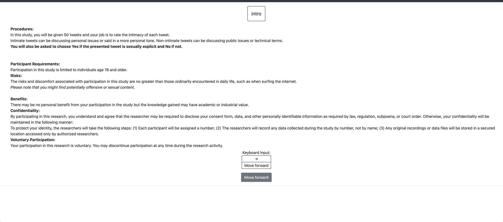

# Multi-Phase Workflows

Potato supports multi-phase annotation workflows that guide annotators through a structured sequence of stages. This is useful for setting up consent forms, pre-screening questions, training/qualification, the main annotation task, and post-study surveys.

## Phase System Overview

Potato's workflow consists of the following phases (in order):

| Phase | Purpose | Required |
|-------|---------|----------|
| `consent` | Collect informed consent | Optional |
| `prestudy` | Pre-screening questions, demographics | Optional |
| `instructions` | Task instructions and guidelines | Optional |
| `training` | Qualification/training with feedback | Optional |
| `annotation` | Main annotation task | Required |
| `poststudy` | Post-study surveys, feedback | Optional |

Users automatically progress through enabled phases in this order.

Pages can be skipped by earlier answers (`show_when`), end the study for a
participant (`exit_when`), be counterbalanced, or randomize their questions.
Participants can be assigned to between-subjects conditions. See
[Experiment Flow](experiment_flow.md). A page can also run a jsPsych timeline,
Potato's headphone check, or a task on another server such as oTree or
Empirica; see [Runtime Phases](runtime_phases.md).

## Back Navigation

By default, the **Back button is hidden** when there is no previous page to navigate to. This means:

- On the very first page of the workflow (e.g., the consent page), the Back button is not shown.
- On the first annotation instance, the Back button is hidden unless phase back-navigation is enabled.

To allow users to navigate backward across phases (e.g., from the annotation phase back to the instructions phase), set:

```yaml
allow_phase_back_navigation: true
```

When this is enabled, the Back button will appear on all pages, allowing users to return to previous phases. When disabled (the default), users can only navigate backward within the current phase — for example, moving between annotation instances or between pages within a multi-page instructions phase.

## Configuration

### Modern Phases Configuration (Recommended)

The recommended way to configure multi-phase workflows is using the `phases` section in your YAML config:

```yaml
phases:
  order: [consent, prestudy, instructions, annotation, poststudy]

  consent:
    type: consent
    file: surveyflow/consent.json

  prestudy:
    type: prestudy
    file: surveyflow/prescreening.json

  instructions:
    type: instructions
    file: surveyflow/instructions.html

  poststudy:
    type: poststudy
    file: surveyflow/demographics.json
```

### Phase Types

Each file-based phase has a **`type`** that tells Potato which stage of the
workflow it belongs to. Valid values are:

| `type` | Purpose |
|--------|---------|
| `consent` | Informed consent |
| `prestudy` | Pre-screening / demographics shown before annotation |
| `instructions` | Task instructions (supports `.html` or survey JSON) |
| `training` | Qualification/training with feedback |
| `annotation` | The main annotation task |
| `poststudy` | Post-study survey / feedback |

Always set `type` explicitly. As a convenience, if you omit `type` **and** the
phase's name is itself one of the values above (e.g. a phase literally named
`consent`), Potato infers the type from the name. Custom-named phases (e.g.
`intro`, `feedback`) **must** declare a `type`:

```yaml
phases:
  order: [intro, consent, instructions, annotation, feedback]

  intro:
    type: prestudy          # custom name -> type is required
    file: surveyflow/intro.json

  consent:
    type: consent
    file: surveyflow/consent.json

  instructions:
    type: instructions
    file: surveyflow/instructions.json

  feedback:
    type: poststudy         # custom name -> type is required
    file: surveyflow/feedback.json
```

> Note: the `annotation` phase needs no `file` — it uses the project's
> top-level `annotation_schemes`.

### Phase Data Files

Each phase references a data file containing the questions or content for that phase.

#### JSON Format for Survey Questions

A question file is a JSON array of annotation schemes, written the same way as
the entries in `annotation_schemes`. Every question needs `annotation_type`,
`name` and `description`; the server refuses to start on a file where one is
missing, and names the entry.

```json
[
  {
    "name": "age_consent",
    "annotation_type": "radio",
    "description": "I certify that I am at least 18 years of age.",
    "labels": ["I agree", "I disagree"],
    "label_requirement": {"required_label": ["I agree"]}
  },
  {
    "name": "read_consent",
    "annotation_type": "radio",
    "description": "I have read and understood the information above.",
    "labels": ["Yes", "No"],
    "label_requirement": {"required_label": ["Yes"]}
  }
]
```

#### Question Types

Survey questions use the same annotation types as `annotation_schemes`. The
usual ones are:

- `radio` - Single choice from options
- `multiselect` - Multiple selections
- `text` - Free text response
- `number` - Numeric input
- `likert` - Likert scale rating (`size`, `min_label`, `max_label`)
- `select` - Dropdown selection

Standard instruments such as `phq-9` or `bfi-10` can be added by ID with
`instrument:` or `instruments:` on the phase; see
[Survey Instruments](../advanced/survey_instruments.md).

### Label Requirements

`label_requirement` decides whether a participant can leave the page:

```json
{
  "name": "age_check",
  "annotation_type": "radio",
  "description": "Are you at least 18 years old?",
  "labels": ["Yes", "No"],
  "label_requirement": {"required_label": ["Yes"]}
}
```

- `required_label`: the answers that let the participant continue. Any other
  answer keeps them on the page.
- `required: true`: the question must be answered, with any answer.

Both are checked by the server when the page is submitted, not only by the
browser, so a participant cannot skip a required question by posting the page
directly. A question hidden by its `display_logic` is not required. To screen
people out on an answer instead of holding them on the page, use `exit_when`
(see [Experiment Flow](experiment_flow.md)).

## Pre-Screening Questions



Pre-screening questions appear before the main annotation task. Use them to:
- Verify eligibility (age, consent)
- Collect demographic information
- Assess prior knowledge

### Example Prestudy Configuration

```yaml
phases:
  order: [prestudy, annotation]
  prestudy:
    type: prestudy
    file: surveyflow/prescreening.json
```

**prescreening.json:**
```json
[
  {
    "name": "country",
    "annotation_type": "select",
    "description": "Which country do you live in?",
    "use_predefined_labels": "country",
    "label_requirement": {"required": true}
  },
  {
    "name": "familiarity",
    "annotation_type": "likert",
    "description": "How familiar are you with this topic?",
    "size": 5,
    "min_label": "Not at all",
    "max_label": "Extremely",
    "label_requirement": {"required": true}
  }
]
```

## Post-Study Surveys


Post-study surveys appear after annotation is complete:

```yaml
phases:
  order: [annotation, poststudy]
  poststudy:
    type: poststudy
    file: surveyflow/demographics.json
```

**demographics.json:**
```json
[
  {
    "name": "gender",
    "annotation_type": "radio",
    "description": "What gender do you most closely identify with?",
    "labels": ["Male", "Female", "Non-binary", "Prefer not to say"],
    "label_requirement": {"required": true}
  },
  {
    "name": "feedback",
    "annotation_type": "text",
    "description": "Please share any feedback about this study (optional)"
  }
]
```

## Built-in Question Templates

A `select` question can take its options from one of three built-in lists
with `use_predefined_labels`: `country`, `ethnicity` or `religion`.

```json
{
  "name": "religion",
  "annotation_type": "select",
  "description": "What is your religion?",
  "use_predefined_labels": "religion"
}
```

## Complete Example

Here's a complete multi-phase workflow configuration:

```yaml
annotation_task_name: "Sentiment Annotation Study"

# Enable multi-phase workflow
phases:
  order: [consent, prestudy, instructions, training, annotation, poststudy]

  consent:
    type: consent
    file: phases/consent.json

  prestudy:
    type: prestudy
    file: phases/demographics.json

  instructions:
    type: instructions
    file: phases/instructions.html

  poststudy:
    type: poststudy
    file: phases/exit_survey.json

# Training phase configuration (optional)
training:
  enabled: true
  data_file: phases/training_questions.json
  passing_criteria:
    min_correct: 3
    max_attempts: 2

# Main annotation configuration
data_files:
  - data/instances.json

annotation_schemes:
  - name: sentiment
    annotation_type: radio
    labels: [Positive, Negative, Neutral]
    description: "Select the sentiment of this text"
```

## Free Response Fields

A `radio` or `multiselect` question can add a free-text box after its
options with `has_free_response`:

```json
{
  "name": "gender_self",
  "annotation_type": "radio",
  "description": "What is your gender?",
  "labels": ["Woman", "Man", "Non-binary", "Prefer not to disclose", "Prefer to self-describe"],
  "has_free_response": {"instruction": "Please specify:"},
  "label_requirement": {"required": true}
}
```

## Conditional Questions (Display Logic)

Survey questions can be shown or hidden based on earlier answers, so you can build
adaptive surveys without splitting the workflow into extra phases — reveal a follow-up
only when it is relevant, show a free-text box when "Other" is picked, or ask for an
explanation only on a low rating.

Add a `display_logic` block to any survey question. Because survey questions go through
the same schema pipeline as annotation schemes, they reference other questions by their
**`name`** (not `id`):

```json
[
  {
    "name": "prior_experience",
    "annotation_type": "radio",
    "description": "Have you previously worked on a text-annotation task?",
    "labels": ["Yes", "No"],
    "label_requirement": {"required": true}
  },
  {
    "name": "experience_details",
    "annotation_type": "text",
    "description": "Please briefly describe your previous annotation experience.",
    "label_requirement": {"required": true},
    "display_logic": {
      "show_when": [
        {"schema": "prior_experience", "operator": "equals", "value": "Yes"}
      ]
    }
  }
]
```

`experience_details` stays hidden — and is excluded from required-field validation, so it
never blocks the **Continue** button — until the participant answers "Yes".

Key behaviors specific to SurveyFlow:

- **Cross-page conditions.** A poststudy question can condition on a prestudy answer;
  references resolve against questions on **any** phase. Earlier-phase answers are injected
  into each page so the condition is evaluated on load.
- **Startup validation.** Invalid survey `display_logic` (unknown operator, a reference to a
  question that exists on no phase, or a circular dependency) fails fast when the server starts.
- **Server-side enforcement.** With `export_include_phase_data: true`, Potato re-evaluates
  each participant's answers server-side and excludes answers to questions they never actually
  saw. Opt out with `exclude_hidden_survey_answers: false` (answers are kept, tagged `hidden`).
- **JSON/instrument questions only.** An `instructions` phase pointing at a raw `.html` file
  bypasses the schema pipeline, so `display_logic` does not apply there.

The full operator reference (`equals`, `contains`, `matches`, numeric/range, emptiness, text
length), `all`/`any` logic, and troubleshooting are documented in
[Conditional Logic](../configuration/conditional_logic.md). A runnable example lives at
`examples/advanced/surveyflow-conditional-logic/`:

```bash
python potato/flask_server.py start examples/advanced/surveyflow-conditional-logic/config.yaml -p 8000
```

---

## Moving from `surveyflow`

Potato 1.x configured survey pages in a `surveyflow` block. Potato 2.x does
not read it: a config that still has one starts, but shows no survey pages.
Move the pages into `phases`:

| `surveyflow` (1.x) | `phases` (2.x) |
|--------|--------|
| `surveyflow.on: true` | a `phases` section |
| `surveyflow.pre_annotation` | `phases.consent` or `phases.prestudy` |
| `surveyflow.post_annotation` | `phases.poststudy` |
| `surveyflow.testing` | `training.data_file` |
| `.jsonl` question files | `.json` files holding an array of schemes |
| `id`, `text`, `schema`, `choices` | `name`, `description`, `annotation_type`, `labels` |
| `label_requirement.right_label` | `label_requirement.required_label` |
| `surveyflow_html_layout` | `task_layout` on the phase |

## Related Documentation

- [Conditional Logic](../configuration/conditional_logic.md) - Show/hide survey questions based on prior answers
- [Experiment Flow](experiment_flow.md) - Page branching, screen-outs, conditions, counterbalancing
- [Runtime Phases](runtime_phases.md) - jsPsych timelines, the headphone check, and external tasks as phase pages
- [jsPsych Phase](jspsych_phase.md) - Run a jsPsych timeline as a phase page
- [Training Phase](training_phase.md) - Configure qualification training with feedback
- [Category-Based Assignment](../advanced/category_assignment.md) - Assign tasks based on training performance
- [Configuration](../configuration/configuration.md) - Full configuration reference
